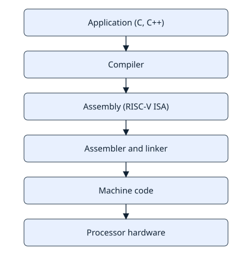

# 1-D1SK1_L2_From_apps_to_hardware

## Overview

A program written in a high-level language passes through several layers before hardware can run it.

---

## Key Concepts

- **Application:** what the user runs.
- **Operating system:** manages memory, files and devices, and provides services to applications.
- **Compiler:** translates C or C++ into assembly for the target ISA.
- **Assembler and linker:** the assembler produces machine code in object files; the linker combines them with libraries into an executable.
- **Hardware:** the processor fetches, decodes and executes the machine code.

The hardware itself is described in a hardware description language (RTL), then turned into a gate-level netlist by synthesis and into a chip layout by physical design.

---

## My Lab Work and Results

**To do:** Pick one line of C and write down the assembly instructions your compiler produces for it.

<!-- Add your own code, observations and screenshots here.
     Screenshot folder: images/lec1/
     Format:  -->

---

## Summary

- The ISA is the boundary between software and hardware.
- The same C code compiles to different instructions for different ISAs.
