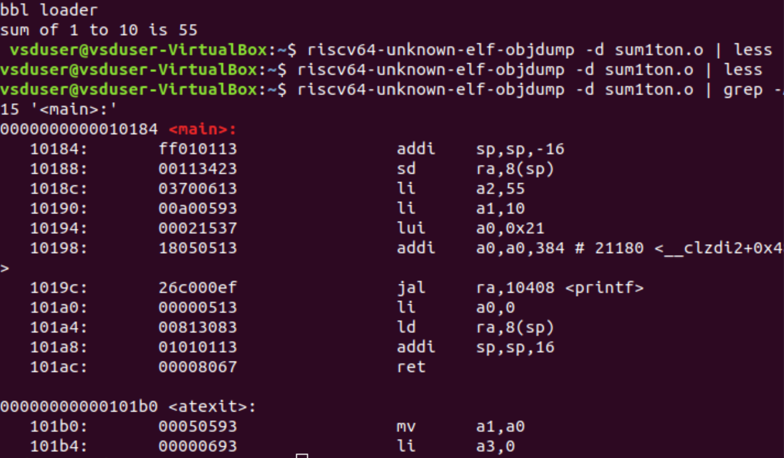
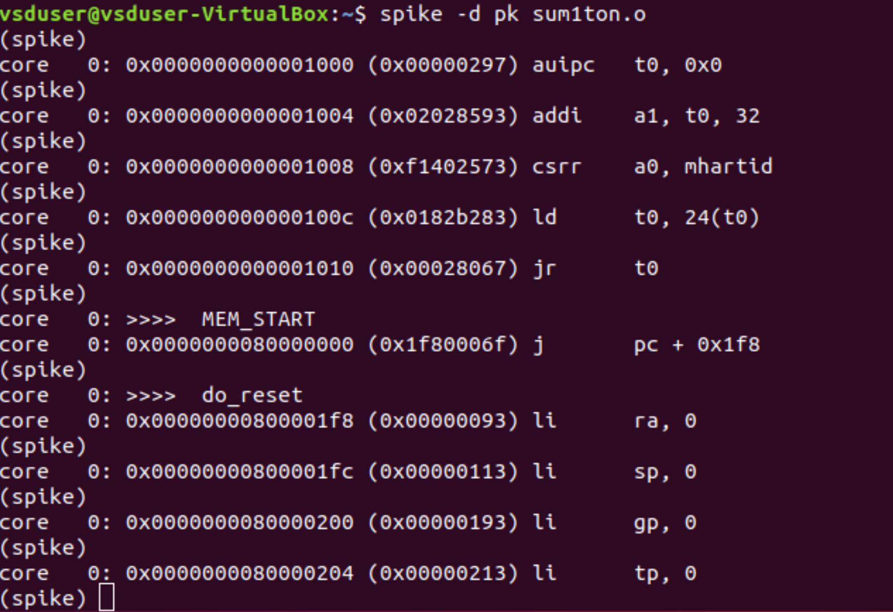

# 3-D1SK2_L2_GCC_compile_and_disassemble

## Overview

A cross-compiler runs on one kind of machine and produces code for another. Here it produces RISC-V code.

---

## Key Concepts

```bash
riscv64-unknown-elf-gcc -O1 -mabi=lp64 -march=rv64i -o sum1ton.o sum1ton.c
riscv64-unknown-elf-objdump -d sum1ton.o | less
```

| Option | Meaning |
|---|---|
| `-O1` | Basic optimisation |
| `-Ofast` | Aggressive optimisation that may relax strict standards rules |
| `-march=rv64i` | Target the 64-bit base integer ISA |
| `-mabi=lp64` | `long` and pointers are 64 bits; no floating-point argument registers |
| `-d` | Disassemble the code sections |

In `less`, type `/<main>:` to find the main function. Each RV64I instruction is 4 bytes, so consecutive addresses differ by 4. The number of instructions in `main` is the difference between its start address and the next function's start address, divided by 4.

---

## My Lab Work and Results

**To do:** Compare the instruction count of `main` with `-O1` and `-Ofast`. Record what you see.
### Commands Used

```bash
riscv64-unknown-elf-gcc -O1 -mabi=lp64 -march=rv64i -o sum1ton_O1.o sum1ton.c
riscv64-unknown-elf-objdump -d sum1ton_O1.o | less

riscv64-unknown-elf-gcc -Ofast -mabi=lp64 -march=rv64i -o sum1ton_Ofast.o sum1ton.c
riscv64-unknown-elf-objdump -d sum1ton_Ofast.o | less
```

### Disassembly with -O1



### Disassembly with -Ofast



### Comparison

| Setting | Instructions in `main` |
|---|---|
| `-O1` | <your count> |
| `-Ofast` | <your count> |

### Observations

- <Are the counts the same or different?>
- <Do you see a loop, or is the sum loaded directly as a constant?>
- <Is the order of the instructions the same?>

---

## Summary

- `objdump` shows the instructions the processor will run.
- Optimisation settings can change the generated code.
