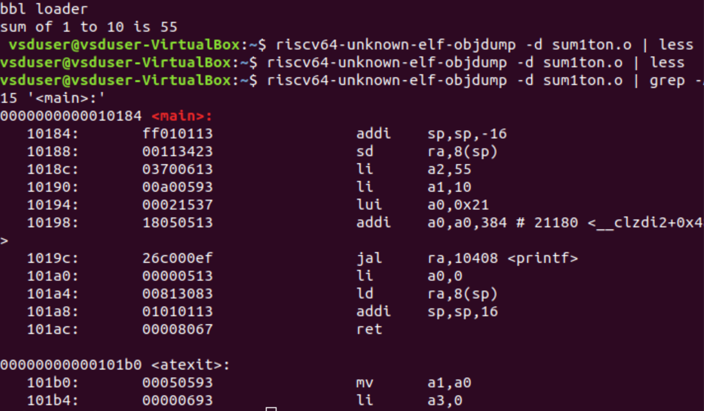
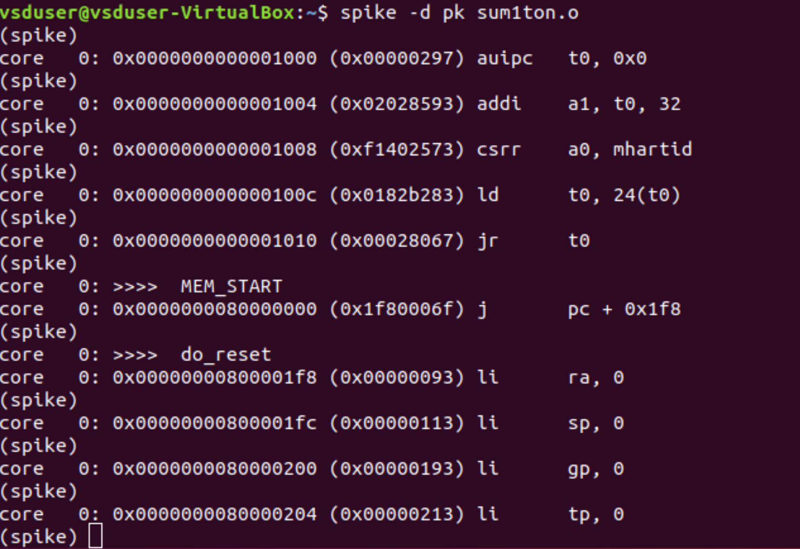

# 4-D1SK2_L3_Spike_simulation_and_debug

## Overview

Spike is a RISC-V ISA simulator. With the proxy kernel (`pk`), it can run a compiled program and step through it.

---

## Key Concepts

```bash
spike pk sum1ton.o          # run the program
spike -d pk sum1ton.o       # start the interactive debugger
```

| Debugger command | Action |
|---|---|
| `until pc 0 <address>` | Run core 0 until the program counter reaches the address |
| `reg 0 a0` | Show register a0 of core 0 |
| Enter | Execute one instruction |
| `q` | Quit |

Take the address of `main` from your own disassembly. Check a register before and after an instruction to confirm what it changed.

---

## My Lab Work and Results

**To do:** Show that Spike gives the same output as the host run, then trace two instructions and note the register changes.

## My Lab Work and Results

### Commands Used

```bash
riscv64-unknown-elf-gcc -O1 -mabi=lp64 -march=rv64i -o sum1ton_O1.o sum1ton.c
riscv64-unknown-elf-objdump -d sum1ton_O1.o | less

riscv64-unknown-elf-gcc -Ofast -mabi=lp64 -march=rv64i -o sum1ton_Ofast.o sum1ton.c
riscv64-unknown-elf-objdump -d sum1ton_Ofast.o | less
```

### Disassembly with -O1



### Disassembly with -Ofast



### Comparison

| Setting | Address of `main` | Instructions in `main` |
|---|---|---|
| `-O1` | `0x10184` | 11 |
| `-Ofast` | `0x100b0` | 11 |

### Observations

- Both settings give 11 instructions in `main`.
- Neither version has a summing loop in `main`. `li a2,55` loads the result directly, so the sum was calculated during compilation.
- The instruction order differs. `-Ofast` places `lui a0,0x21` first and moves `sd ra,8(sp)` later.
- `main` is at a different address in the two programs.
- For this program, `-Ofast` did not reduce the instruction count.
---

## Summary

- Simulation checks software behaviour without RISC-V hardware.
