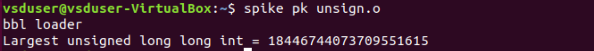

# 5-D1SK3_L1_Unsigned_numbers

## Overview

An unsigned number uses every bit for magnitude.

---

## Key Concepts

Bit *i* has the weight 2^i. For example, 1011 in binary is 8 + 0 + 2 + 1 = 11.

With N bits there are 2^N patterns, covering 0 to 2^N - 1.

| Width | Largest unsigned value |
|---|---|
| 8 bits (byte) | 255 |
| 32 bits (word) | 4,294,967,295 |
| 64 bits (doubleword) | 18,446,744,073,709,551,615 |

Unsigned arithmetic in C wraps around modulo 2^N. In 8 bits, 255 + 1 gives 0.

---

## My Lab Work and Results

**To do:** Print the largest `unsigned long long int` value from a C program.

## My Lab Work and Results

### C Program

```c
#include <stdio.h>
#include <limits.h>

int main(void) {
    unsigned long long int max = ULLONG_MAX;
    printf("Largest unsigned long long int = %llu\n", max);
    return 0;
}
```

### Commands Used

```bash
riscv64-unknown-elf-gcc -O1 -mabi=lp64 -march=rv64i -o unsigned_max.o unsigned_max.c
spike pk unsigned_max.o
```




### Observations

- The largest `unsigned long long int` value here is `18446744073709551615`.
- It is 64 bits wide, so its range is 0 to 2^64 - 1.
- At the largest value, all 64 bits are 1.
- `ULLONG_MAX` from `limits.h` gives this value, and `%llu` prints it.
- Adding 1 to this unsigned value wraps it around to 0. This program does not test that.
---

## Summary

- N bits cover 0 to 2^N - 1.
