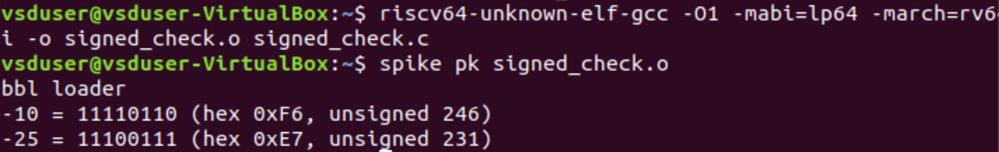

# 6-D1SK3_L2_Signed_numbers

## Overview

RISC-V represents signed integers in two's complement.

---

## Key Concepts

The most significant bit has a negative weight, -2^(N-1). All other bits keep their positive weights.

To negate a number, invert every bit and add 1. In 8 bits:

```text
 5      = 0000 0101
 invert = 1111 1010
 add 1  = 1111 1011  = -5
```

The range is -2^(N-1) to 2^(N-1) - 1, which is -128 to 127 for 8 bits. The same adder works for both signed and unsigned values.

---

## My Lab Work and Results

**To do:** Convert two negative numbers by hand and check them with a program.

## My Lab Work and Results

### Hand Conversion (8-bit Two's Complement)

Method: write the positive number in binary, invert all the bits, then add 1.

**Example 1: -10**

```text
+10      = 0000 1010
Invert   = 1111 0101
Add 1    = 1111 0110  (-10)
```

Check: -128 + 64 + 32 + 16 + 4 + 2 = -10

**Example 2: -25**

```text
+25      = 0001 1001
Invert   = 1110 0110
Add 1    = 1110 0111  (-25)
```

Check: -128 + 64 + 32 + 4 + 2 + 1 = -25

### C Program

```c
#include <stdio.h>
#include <stdint.h>

void show(int8_t x) {
    uint8_t u = (uint8_t)x;
    printf("%d = ", x);
    for (int i = 7; i >= 0; i--)
        printf("%d", (u >> i) & 1);
    printf(" (hex 0x%02X, unsigned %u)\n", u, u);
}

int main(void) {
    show(-10);
    show(-25);
    return 0;
}
```

### Commands Used

```bash
riscv64-unknown-elf-gcc -O1 -mabi=lp64 -march=rv64i -o signed_check.o signed_check.c
spike pk signed_check.o
```

### Output



### Comparison

| Number | By hand | From program | Hex | Same bits read as unsigned |
|---|---|---|---|---|
| -10 | 1111 0110 | 11110110 | 0xF6 | 246 |
| -25 | 1110 0111 | 11100111 | 0xE7 | 231 |

### Observations

- The program results match the hand conversions.
- The most significant bit is 1 for both negative numbers.
- For these 8-bit negative numbers, the unsigned reading equals 256 plus the signed value.
---

## Summary

- The top bit tells the sign.
- There is one more negative value than positive.
