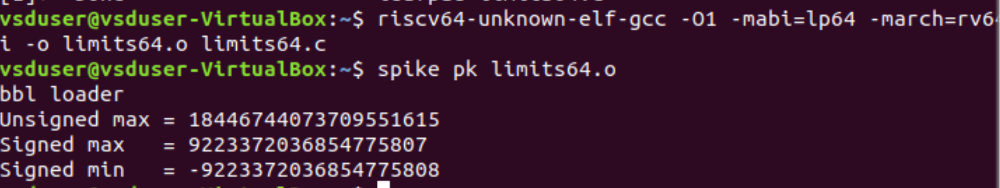

# 7-D1SK3_L3_Signed_and_unsigned_lab

## Overview

The same bit pattern can mean different values depending on how it is read.

---

## Key Concepts

In 8 bits, `1111 1111` is 255 when unsigned and -1 when signed.

| C type (RV64, LP64) | Size | Format |
|---|---|---|
| `unsigned int` | 32 bits | `%u` |
| `int` | 32 bits | `%d` |
| `unsigned long long int` | 64 bits | `%llu` |
| `long long int` | 64 bits | `%lld` |

The 64-bit signed range is -9,223,372,036,854,775,808 to 9,223,372,036,854,775,807.

RISC-V has separate instructions where the interpretation matters, such as `slt` and `sltu`, or `lb` (sign-extends) and `lbu` (zero-extends). Overflow of signed integers is undefined behaviour in C, so do not rely on it wrapping.

---

## My Lab Work and Results

**To do:** Print the signed and unsigned 64-bit limits and explain the output.

## My Lab Work and Results

### C Program

```c
#include <stdio.h>
#include <limits.h>

int main(void) {
    printf("Unsigned max = %llu\n", ULLONG_MAX);
    printf("Signed max   = %lld\n", LLONG_MAX);
    printf("Signed min   = %lld\n", LLONG_MIN);
    return 0;
}
```

### Commands Used

```bash
riscv64-unknown-elf-gcc -O1 -mabi=lp64 -march=rv64i -o limits64.o limits64.c
spike pk limits64.o
```

### Output



### Explanation

| Value | Formula | 64-bit pattern (hex) |
|---|---|---|
| Unsigned maximum | 2^64 - 1 | `0xFFFFFFFFFFFFFFFF` |
| Signed maximum | 2^63 - 1 | `0x7FFFFFFFFFFFFFFF` |
| Signed minimum | -2^63 | `0x8000000000000000` |

- **Unsigned:** all 64 bits represent magnitude, so the range is 0 to 2^64 - 1.
- **Signed:** in two's complement, the top bit has a weight of -2^63, so the range is -2^63 to 2^63 - 1.
- Both types have 2^64 possible bit patterns. They interpret those patterns differently.
- The negative side has one more value than the positive side, because zero uses one of the patterns whose top bit is 0.
- `%llu` prints an unsigned 64-bit value here, and `%lld` prints a signed one.

---

## Summary

- Bits have no sign by themselves; the instruction or type decides.
