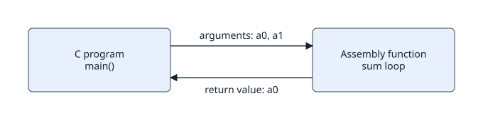
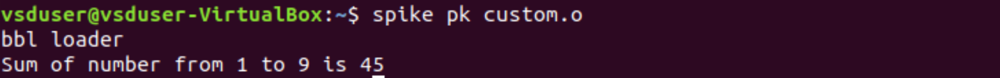

# 11-D2SK2_L1_Sum_of_1_to_N_using_assembly

## Overview

A C program can call an assembly function when both follow the ABI. The loop for 1 to N can be written in assembly.

---

## Key Concepts



The algorithm:
1. Take the start value (0) in `a0` and the limit (N + 1) in `a1`.
2. Set a loop limit, a running sum and a counter in registers.
3. Add the counter to the sum, then add 1 to the counter.
4. Repeat while the counter is less than the limit (`blt`).
5. Put the sum in `a0` and return with `ret`.

In C, declare the function with `extern` so the compiler knows its arguments and return type.

---

## My Lab Work and Results

### C Program: `1to9_custom.c`

```c
#include <stdio.h>

extern int load(int x, int y);

int main() {
    int result = 0;
    int count = 9;
    result = load(0x0, count+1);
    printf("Sum of number from 1 to %d is %d\n", count, result);
}
```

### Assembly Program: `load.S`

```asm
.section .text
.global load
.type load, @function

load:
        add     a4, a0, zero    # Initialize sum register a4 with 0
        add     a2, a0, a1      # Store the loop limit 10 in a2
        add     a3, a0, zero    # Initialize counter register a3 with 0
loop:   add     a4, a3, a4      # Add the counter to the sum
        addi    a3, a3, 1       # Increment the counter by 1
        blt     a3, a2, loop    # Repeat while a3 is less than a2
        add     a0, a4, zero    # Put the result in a0
        ret
```

### Commands Used

```bash
riscv64-unknown-elf-gcc -O1 -mabi=lp64 -march=rv64i -o 1to9_custom.o 1to9_custom.c load.S
spike pk 1to9_custom.o
```

### Output



---

## Summary

- `a0` carries the first argument and the return value.
