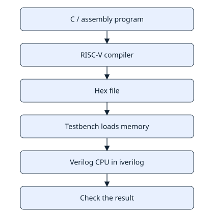

# 13-D2SK3_L1_Run_program_on_RISC_V_CPU

## Overview

A RISC-V CPU written in Verilog can run a compiled program in simulation. Icarus Verilog (`iverilog`) is the simulator.

---

## Key Concepts



1. Compile the program for RISC-V.
2. Convert it to a hex file that the testbench can load into memory.
3. Simulate the CPU and testbench.
4. Compare the CPU result with the expected result.

The general commands, using your lab's file names:

```bash
iverilog -o cpu_sim testbench.v cpu.v
vvp cpu_sim
```

The CPU must support every instruction that the compiled program uses.

---

## My Lab Work and Results

**To do:** Record the script or commands from your lab and the simulation output.

<!-- Add your own code, observations and screenshots here.
     Screenshot folder: images/lec13/
     Format:  -->

---

## Summary

- A testbench loads the program, drives the clock and reset, and checks results.
