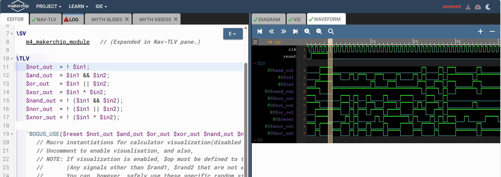
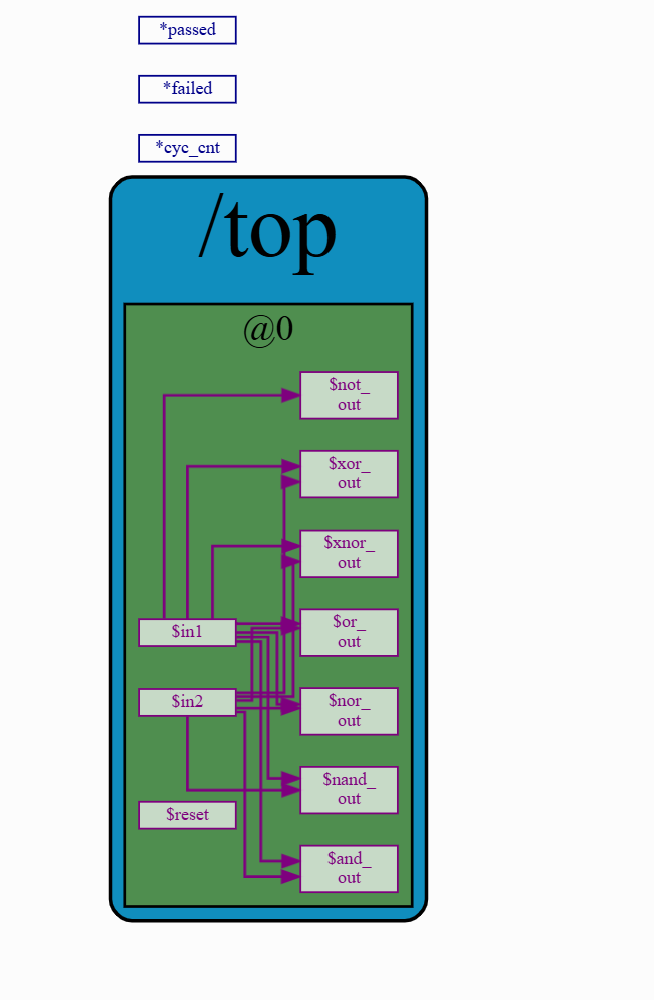

# D3SK1 L1: Logic Gates in TL-Verilog Using Makerchip

## Overview

Combinational logic has outputs that depend only on the present inputs. Makerchip is a browser-based IDE for TL-Verilog.

---

## Key Concepts

| Gate | TL-Verilog expression |
|---|---|
| NOT | `$out = ! $in1;` |
| AND | `$out = $in1 && $in2;` |
| OR | `$out = $in1 \|\| $in2;` |
| XOR | `$out = $in1 ^ $in2;` |
| NAND | `$out = ! ($in1 && $in2);` |
| NOR | `$out = ! ($in1 \|\| $in2);` |
| XNOR | `$out = ! ($in1 ^ $in2);` |

In TL-Verilog, signals start with `$` and do not need a separate declaration. Makerchip shows the generated diagram, waveforms and any visualisation.

---

## My Lab Work and Results

### TL-Verilog Code

The following lines go in the `\TLV` section of the default Makerchip template:

```tlv
   // Basic logic gates
   $not_out  = ! $in1;
   $and_out  = $in1 && $in2;
   $or_out   = $in1 || $in2;
   $xor_out  = $in1 ^ $in2;
   $nand_out = ! ($in1 && $in2);
   $nor_out  = ! ($in1 || $in2);
   $xnor_out = ! ($in1 ^ $in2);

   `BOGUS_USE($reset $not_out $and_out $or_out $xor_out $nand_out $nor_out $xnor_out)
```

The inputs `$in1` and `$in2` are left unassigned, so Makerchip supplies random test values. `BOGUS_USE` marks signals as intentionally unused.

### Block Diagram



### Waveform



### Truth Table

| in1 | in2 | NOT in1 | AND | OR | XOR | NAND | NOR | XNOR |
|---|---|---|---|---|---|---|---|---|
| 0 | 0 | 1 | 0 | 0 | 0 | 1 | 1 | 1 |
| 0 | 1 | 1 | 0 | 1 | 1 | 1 | 0 | 0 |
| 1 | 0 | 0 | 0 | 1 | 1 | 1 | 0 | 0 |
| 1 | 1 | 0 | 1 | 1 | 0 | 0 | 0 | 1 |

### Result

The gate outputs in the waveform follow the truth table for the input values observed.

---

## Summary

- Combinational logic has no memory.
