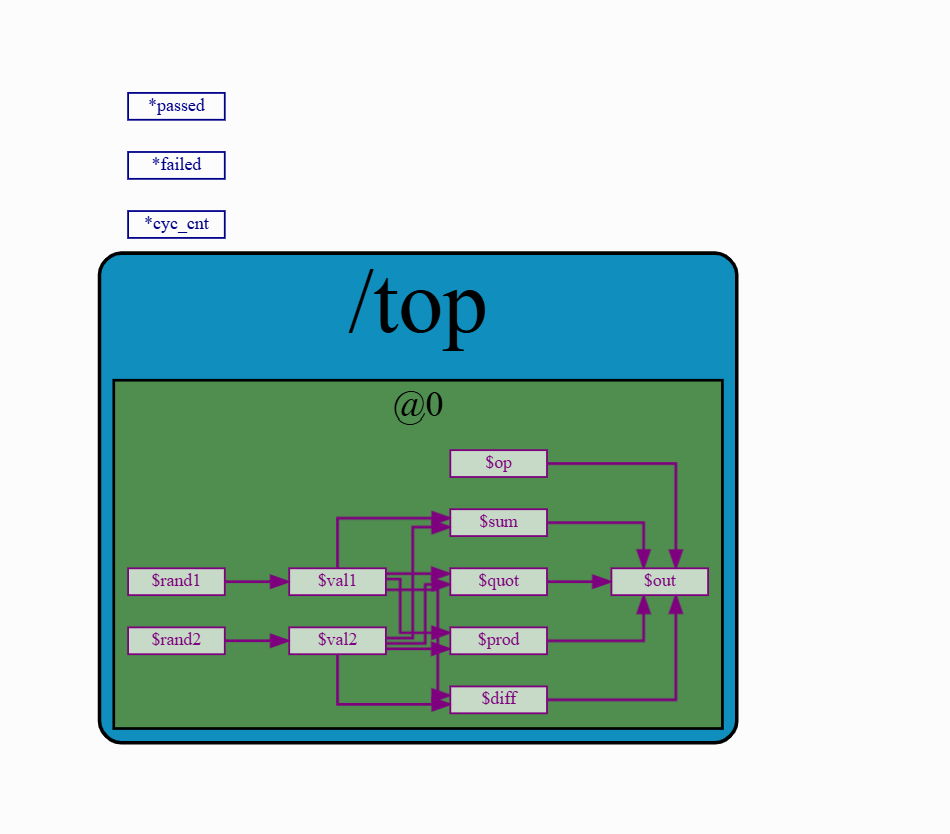
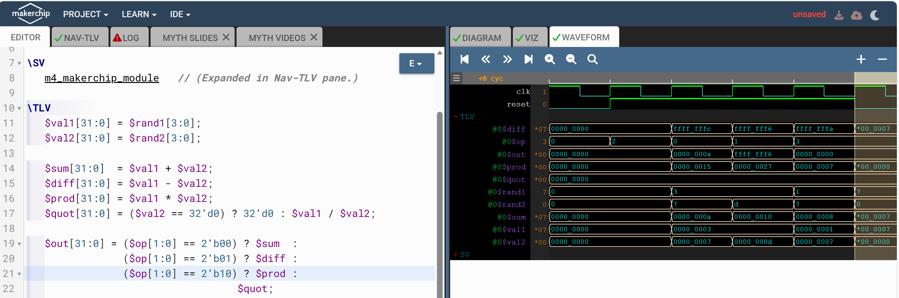

# D3SK1 L2: Multiplexer and Four-Operation Calculator

## Overview

A multiplexer (mux) selects one of several inputs. It is the basis of a simple calculator.

---

## Key Concepts

A two-input mux:

```tlv
$out[7:0] = $sel ? $in1[7:0] : $in0[7:0];
```

For more choices, conditions can be chained. This calculator computes the sum, difference, product and quotient, then uses a 2-bit select signal to choose one result.

| `$op[1:0]` | Operation | Selected signal |
|---|---|---|
| `00` | Addition | `$sum` |
| `01` | Subtraction | `$diff` |
| `10` | Multiplication | `$prod` |
| `11` | Division | `$quot` |

---

## My Lab Work and Results

### TL-Verilog Code

```tlv
$val1[31:0] = $rand1[3:0];
$val2[31:0] = $rand2[3:0];

$sum[31:0]  = $val1 + $val2;
$diff[31:0] = $val1 - $val2;
$prod[31:0] = $val1 * $val2;
$quot[31:0] = ($val2 == 32'd0) ? 32'd0 : $val1 / $val2;

$out[31:0] = ($op[1:0] == 2'b00) ? $sum  :
             ($op[1:0] == 2'b01) ? $diff :
             ($op[1:0] == 2'b10) ? $prod :
                                   $quot;
```

### Block Diagram



### Waveform



### Result

The addition, subtraction, multiplication and division outputs matched the expected results in the tested cycles.

---

## Summary

- A multiplexer selects one result using a select signal.
- A chained conditional gives priority to the first true condition.
