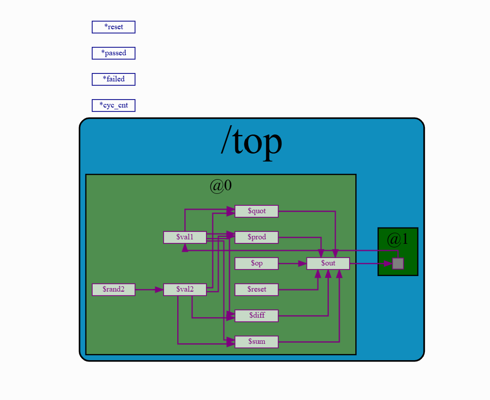
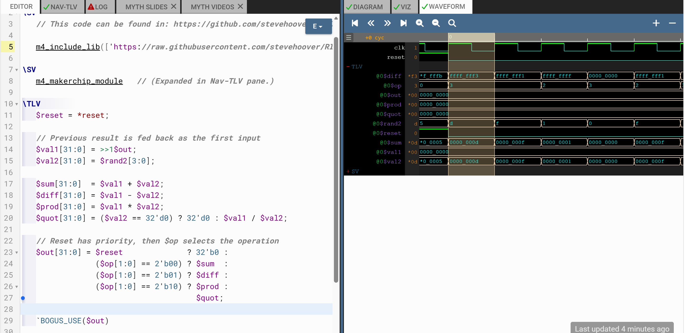

# 16-D3SK2_L1_Counter_and_sequential_calculator

## Overview

Sequential logic stores state, which changes on a clock edge. D flip-flops are the basic storage element.

---

## Key Concepts

In TL-Verilog, `>>1$signal` means the value of the signal one cycle earlier. A free-running counter:

```tlv
$cnt[7:0] = $reset ? 0 : >>1$cnt + 1;
```

Reset gives the state a known starting value. A sequential calculator feeds its previous output back as one operand.

---

## My Lab Work and Results

### TL-Verilog Code

```tlv
$reset = *reset;

// Previous result is fed back as the first input
$val1[31:0] = >>1$out;
$val2[31:0] = $rand2[3:0];

$sum[31:0]  = $val1 + $val2;
$diff[31:0] = $val1 - $val2;
$prod[31:0] = $val1 * $val2;
$quot[31:0] = ($val2 == 32'd0) ? 32'd0 : $val1 / $val2;

// Reset has priority, then $op selects the operation
$out[31:0] = $reset              ? 32'b0 :
             ($op[1:0] == 2'b00) ? $sum  :
             ($op[1:0] == 2'b01) ? $diff :
             ($op[1:0] == 2'b10) ? $prod :
                                   $quot;

`BOGUS_USE($out)
```

### Block Diagram



### Waveform



### Result

In the tested cycles, the output was 0 during reset. After reset, the previous output was used as the first operand, and the selected operation gave the expected result.

---

## Summary

- Feedback through a flip-flop gives a circuit memory.
