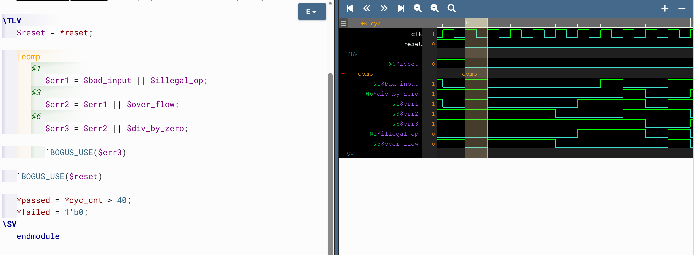

# 17-D3SK3_L1_Pipelined_logic_lab

## Overview

Pipelining splits logic into stages separated by flip-flops. Shorter paths between flip-flops can allow a faster clock.

---

## Key Concepts

In TL-Verilog, `|name` starts a pipeline and `@1`, `@2` mark its stages. This computes a distance from two sides:

```tlv
|calc
   @1
      $aa_sq[31:0] = $aa[3:0] * $aa;
      $bb_sq[31:0] = $bb[3:0] * $bb;
   @2
      $cc_sq[31:0] = $aa_sq + $bb_sq;
   @3
      $cc[31:0] = sqrt($cc_sq);
```

The tool creates the flip-flops between stages. Moving logic to another stage (**retiming**) changes the timing without rewriting the expressions. This style is called timing-abstract design. Latency in cycles may increase, while a new input can still be accepted each cycle.

`sqrt` here relies on the support provided by the simulation environment.

---

## My Lab Work and Results

### 1. Error Conditions in a Computation Pipeline

```tlv
|comp
   @1
      $err1 = $bad_input || $illegal_op;
   @3
      $err2 = $err1 || $over_flow;
   @6
      $err3 = $err2 || $div_by_zero;
```

The error inputs are left unassigned, so Makerchip supplies random test values. TL-Verilog creates the flip-flops that carry `$err1` and `$err2` to later stages.

#### Block Diagram



#### Waveform


**Result:** In the cycles checked, the error signals combined the earlier errors, after the pipeline delay, with the error condition added at that stage.

---

## Summary

- Pipelining can raise throughput; it does not shorten the work for one input.
