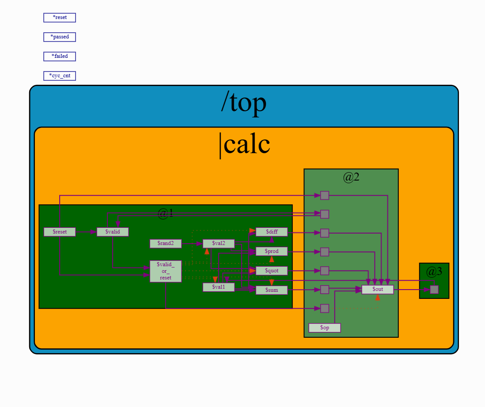
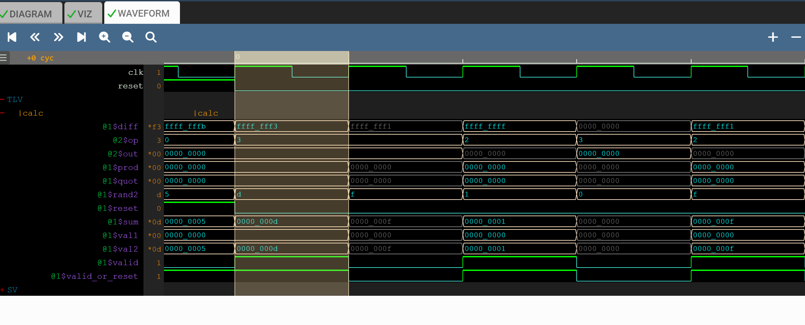

# 18-D3SK4_L1_Validity_lab

## Overview

Validity marks the cycles in which a pipeline carries meaningful data.

---

## Key Concepts

A `?$valid` condition applies to the logic inside it. Values in invalid cycles are treated as don't-care.

Benefits:
- Waveforms are easier to debug.
- Mistakes that use invalid data are easier to find.
- Clocks can be gated for idle logic, which can save power.

---

## My Lab Work and Results

### 2-Cycle Calculator with Validity

- A 1-bit counter makes `$valid` high every second cycle after reset.
- The calculator logic is enabled by `$valid_or_reset`, so it also works during reset.
- The four operations are in stage `@1`.
- The output multiplexer is in stage `@2`.
- `>>2$out` feeds the result from two cycles earlier back to `$val1`.
- Because `$out` is computed under the validity condition, the multiplexer only needs `$reset` to force zero.

### TL-Verilog Code

```tlv
|calc
   @1
      $reset = *reset;

      $valid = $reset ? 1'b0 : >>1$valid + 1'b1;
      $valid_or_reset = $valid || $reset;

   ?$valid_or_reset
      @1
         $val1[31:0] = >>2$out;
         $val2[31:0] = $rand2[3:0];

         $sum[31:0]  = $val1 + $val2;
         $diff[31:0] = $val1 - $val2;
         $prod[31:0] = $val1 * $val2;
         $quot[31:0] = ($val2 == 32'd0) ? 32'd0 : $val1 / $val2;

      @2
         $out[31:0] = $reset              ? 32'b0 :
                      ($op[1:0] == 2'b00) ? $sum  :
                      ($op[1:0] == 2'b01) ? $diff :
                      ($op[1:0] == 2'b10) ? $prod :
                                            $quot;

         `BOGUS_USE($out)
```

### Block Diagram



### Waveform



### Result

In the cycles checked, the output was 0 during reset. After reset, `$valid` was high every second cycle. In each valid cycle, the calculator used the previous result and gave the expected output.

---

## Summary

- A valid signal separates real data from don't-care cycles.
