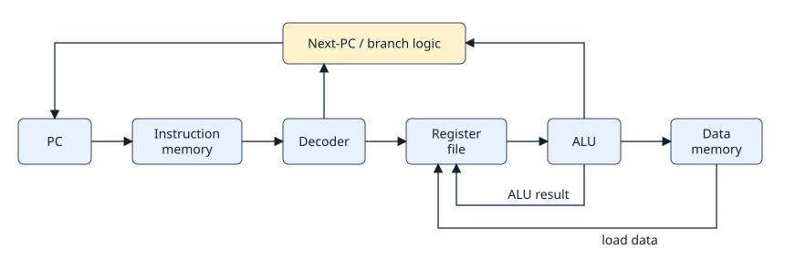
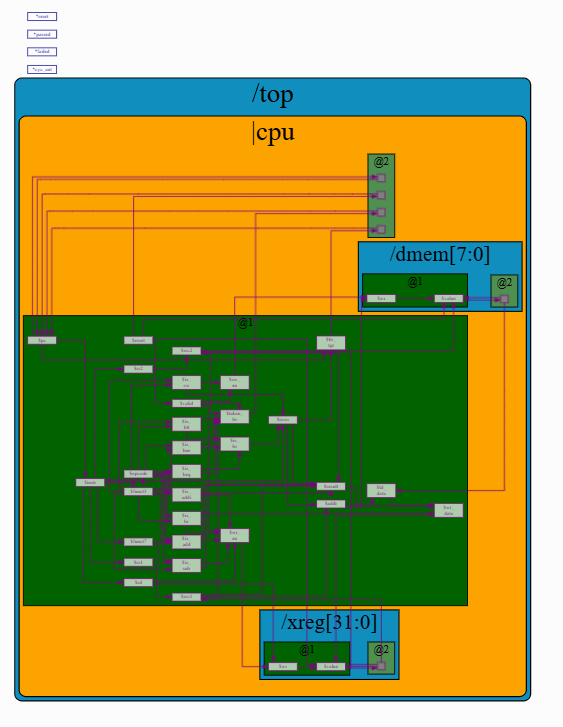
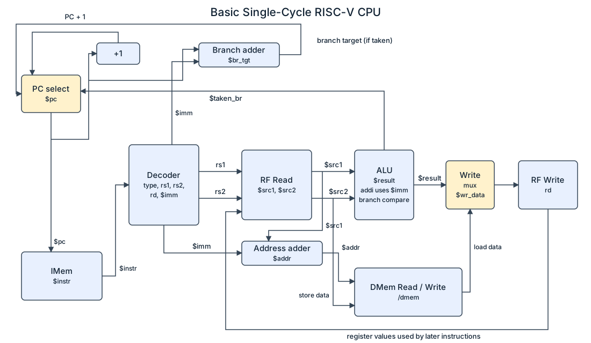

# 21-D4SK1_L1_Single_cycle_CPU_architecture

## Overview

A single-cycle CPU completes one instruction in each clock cycle.

---

## Key Concepts

| Block | Role |
|---|---|
| Program counter (PC) | Holds the address of the instruction |
| Instruction memory | Supplies the instruction at that address |
| Decoder | Finds the operation, registers and immediate |
| Register file | Reads two source registers and writes one destination |
| ALU | Computes results |
| Branch logic | Chooses the next PC |
| Data memory | Serves loads and stores |

---

## My Lab Work and Results

### Makerchip Diagram

The diagram shows the `|cpu` pipeline. The main CPU logic is in stage `@1`, with the data memory (`/dmem[7:0]`) and register file (`/xreg[31:0]`) shown as separate blocks. The boxes in `@2` represent stored values used by later cycles.

### CPU Block Diagram

### TL-Verilog Code

[View the CPU code](../src/basic_riscv_cpu.tlv)

Supported instructions: `add`, `sub`, `addi`, `lw`, `sw`, `beq`, `bne` and `blt`.

### Test Program

The program is designed to add the numbers from 1 to 9, store the sum in data memory and load it into `x15`. The pass condition checks for `x15 = 45`.

### Notes

- The PC in this design counts instructions, so it increases by 1.
- The instruction memory holds a fixed test program.
- The data memory has 8 words and supports aligned word access only.
- Unsupported instructions are not trapped.
- This is a basic teaching CPU, not a full RV32I implementation.

---

## Summary

- A single cycle must be long enough for the slowest instruction.
