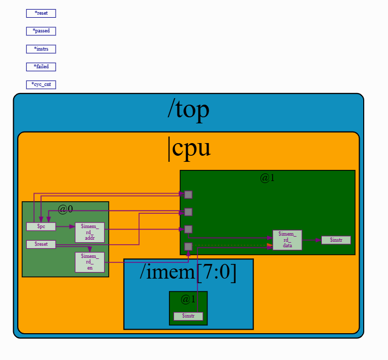
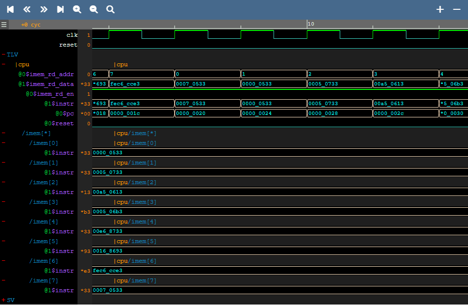

# 23-D4SK2_L1_Program_counter_and_instruction_fetch

## Overview

The program counter selects the next instruction to fetch.

---

## Key Concepts

After reset, the PC starts at the first instruction. RV32I instructions are 4 bytes, so by default:

```text
next PC = current PC + 4
```

A taken branch or a jump supplies a different target. Instruction memory is often indexed by word, so the two lowest address bits are not part of the index. For an aligned 32-bit instruction, they are 00.

---

## My Lab Work and Results

### Instruction Fetch Design

- The PC is generated in stage `@0`. It starts at 0 after reset and advances by 4.
- The instruction memory is enabled in every cycle when reset is inactive.
- The memory is addressed by words, using `$pc[M4_IMEM_INDEX_CNT+1:2]`.
- The fetched instruction is read into `$instr[31:0]` in stage `@1`.

| Signal | Direction (to `imem`) | Purpose |
|---|---|---|
| `$imem_rd_en` | Input | Read enable |
| `$imem_rd_addr` | Input | Word index of the instruction |
| `$imem_rd_data` | Output | 32-bit instruction |

### TL-Verilog Code

This code is used with the course starter file, `risc-v_shell.tlv`:

```tlv
|cpu
   @0
      $reset = *reset;

      // Program counter: byte address
      $pc[31:0] = >>1$reset ? 32'd0 : >>1$pc + 32'd4;

      // Instruction memory interface
      $imem_rd_en = ! $reset;
      $imem_rd_addr[M4_IMEM_INDEX_CNT-1:0] = $pc[M4_IMEM_INDEX_CNT+1:2];

   @1
      $instr[31:0] = $imem_rd_data[31:0];

      `BOGUS_USE($instr)
```

The instruction memory is enabled by this line in the macro section of the starter file:

```tlv
m4+imem(@1)
```

### Makerchip Diagram



The PC and memory inputs are in stage `@0`. The fetched data and `$instr` are in stage `@1`. The instruction memory has 8 entries, `/imem[7:0]`.

### Waveform



### Observations

Each instruction appears in `@1` one cycle after its PC appears in `@0`.

| `$pc` | Memory index | `$instr` in the next cycle |
|---|---|---|
| `0x18` | 6 | `0xFEC6CCE3` |
| `0x1C` | 7 | `0x00070533` |
| `0x20` | 0 | `0x00000533` |
| `0x24` | 1 | `0x00050733` |
| `0x28` | 2 | `0x00A50613` |
| `0x2C` | 3 | `0x000506B3` |

- The PC increases by 4 over the values shown.
- The fetched values match the instruction memory contents shown in the waveform.
- `$imem_rd_en` is 1 and `$reset` is 0 in this window.
- The memory index wraps from 7 to 0, so the instructions repeat. The PC keeps increasing.
- Branch logic is not included yet, so the `blt` instruction does not change the PC.

**Note:** this waveform starts partway through the run and does not show the PC sequence during and immediately after reset.

### Reference

Starter file: [RISC-V MYTH Workshop by stevehoover](https://github.com/stevehoover/RISC-V_MYTH_Workshop)

---

## Summary

- The PC counts bytes, so it advances by 4.
