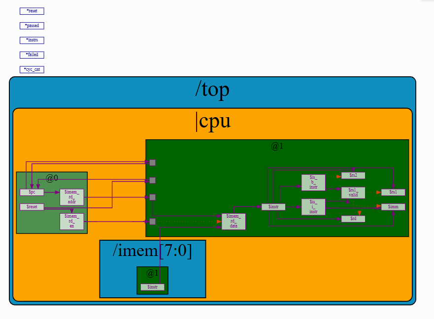
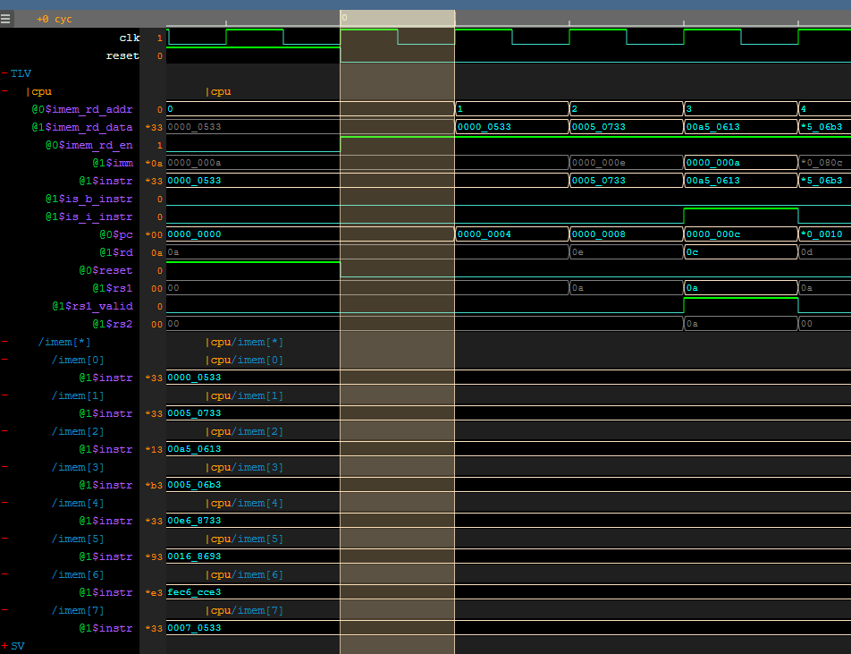
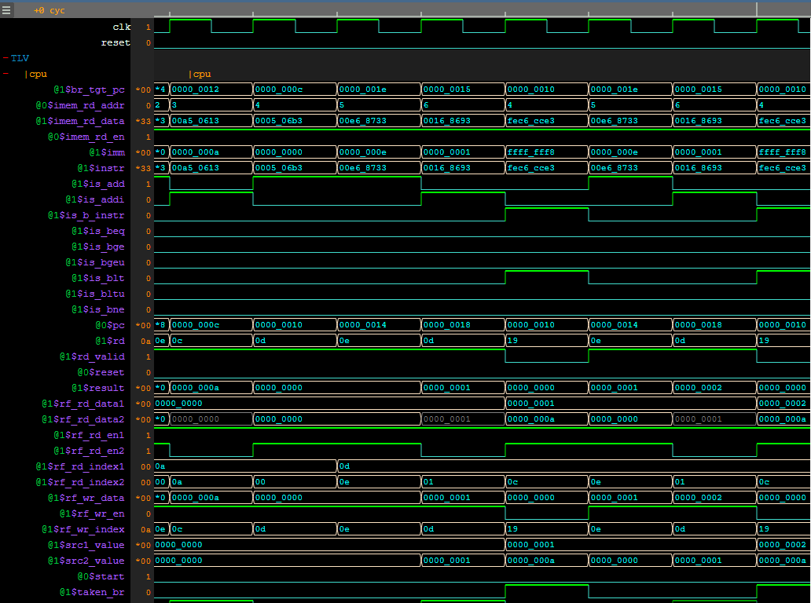

# 24-D4SK2_L2_Instruction_decode

## Overview

Decoding splits the 32-bit instruction into the information the CPU needs.

---

## Key Concepts


| Type | Typical use |
|---|---|
| R | Register arithmetic |
| I | Immediate arithmetic, loads, `jalr` |
| S | Stores |
| B | Conditional branches |
| U | `lui`, `auipc` |
| J | `jal` |

The opcode is in bits 6:0. `funct3` and `funct7` help identify the operation where the format has them. Immediate bits are arranged differently in each format and are sign-extended from instruction bit 31. B and J immediates have an implied lowest bit of 0. A U immediate fills the upper 20 bits, with zeros below.

Fields that a format does not have must not be used.

---

## My Lab Work and Results

### TL-Verilog Code

[View the decode code](../src/lec24_decode_short.tlv)

This short version decodes selected fields of I-type immediate arithmetic and B-type instructions only. It uses when conditions, such as `?$is_b_instr`, for fields that are not always valid.

### Hand Decoding 1: `0x00A50613` (I-type)

```text
imm[11:0]     rs1    funct3  rd     opcode
000000001010  01010  000     01100  0010011
```

`rs1 = x10`, `rd = x12`, `imm = 10` and `funct3 = 000`.

**Instruction:** `addi x12, x10, 10`

### Hand Decoding 2: `0xFEC6CCE3` (B-type)

```text
imm[12] imm[10:5] rs2    rs1    funct3  imm[4:1] imm[11] opcode
1       111111    01100  01101  100     1100     1       1100011
```

The immediate is rebuilt as `imm[12]`, `imm[11]`, `imm[10:5]`, `imm[4:1]` and a final 0:

```text
1 1 111111 1100 0 = 1111111111000 = -8
```

`rs1 = x13`, `rs2 = x12`, `imm = -8` and `funct3 = 100`.

**Instruction:** `blt x13, x12, -8`

`funct3` was decoded by hand. The short code does not output it.

### Makerchip Diagram



### Waveform



### Comparison for `addi`

| Signal | By hand | Waveform |
|---|---|---|
| `$instr` | `00a50613` | `00a50613` |
| `$is_i_instr` | 1 | 1 |
| `$is_b_instr` | 0 | 0 |
| `$rs1` | `0a` | `0a` |
| `$rd` | `0c` | `0c` |
| `$imm` | `0000000a` | `0000000a` |

The shown values match the hand decoding. `rs2` is not a field of this I-type instruction, so its value is ignored.

### Comparison for `blt`



This waveform comes from the later CPU with branch logic ([lec29 code](../src/lec29_valid3.tlv)). It shows the `rs1` and `rs2` fields as `$rf_rd_index1` and `$rf_rd_index2`.

| By hand | Waveform signal | Waveform value |
|---|---|---|
| B-type | `$is_b_instr` | 1 |
| `blt` | `$is_blt` | 1 |
| `rs1 = x13` | `$rf_rd_index1` | `0d` |
| `rs2 = x12` | `$rf_rd_index2` | `0c` |
| `imm = -8` | `$imm` | `fffffff8` |

The shown values match the hand decoding.

---

## Summary

- Register fields stay in the same positions in the formats that use them.
