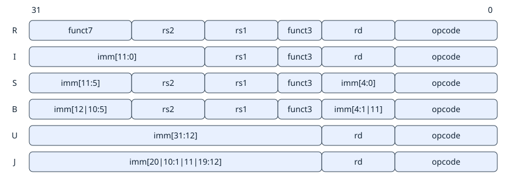

# 24-D4SK2_L2_Instruction_decode

## Overview

Decoding splits the 32-bit instruction into the information the CPU needs.

---

## Key Concepts

| Type | Typical use |
|---|---|
| R | Register arithmetic |
| I | Immediate arithmetic, loads, `jalr` |
| S | Stores |
| B | Conditional branches |
| U | `lui`, `auipc` |
| J | `jal` |

The opcode is in bits 6:0. `funct3` and `funct7` help identify the operation where the format has them. Immediate bits are arranged differently in each format and are sign-extended from instruction bit 31. B and J immediates have an implied lowest bit of 0. A U immediate fills the upper 20 bits, with zeros below.

Fields that a format does not have must not be used.

---

## My Lab Work and Results

**To do:** Decode two instructions from your test program by hand and compare with your waveform.

<!-- Add your own code, observations and screenshots here.
     Screenshot folder: images/lec24/
     Format:  -->

---

## Summary

- Register fields stay in the same positions in the formats that use them.
