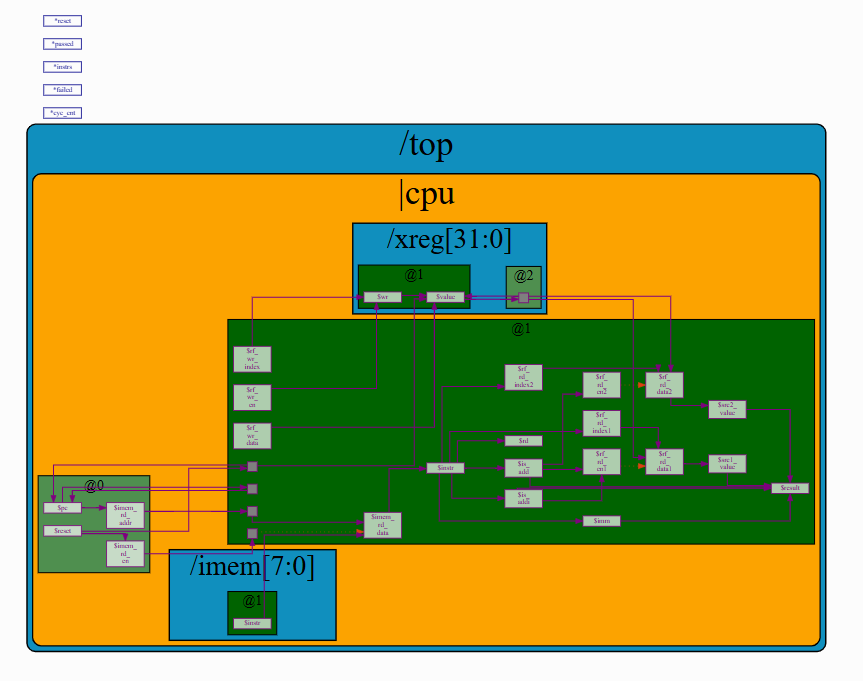

# 25-D4SK2_L3_Register_file_and_ALU

## Overview

The register file supplies operands, and the arithmetic logic unit (ALU) works on them.

---

## Key Concepts

RV32I has 32 registers of 32 bits. A typical CPU register file has two read ports, for `rs1` and `rs2`, and one write port, for `rd`.

Reading is enabled only when the instruction uses that source. The ALU selects a result according to the decoded instruction:

| Instruction | Result |
|---|---|
| `add` | rs1 value + rs2 value |
| `addi` | rs1 value + immediate |

---

## My Lab Work and Results

The ALU gives `$result` for `add` and `addi`, using operands read from the register file. Register writes are off in this lab.

Code: [lec25_alu.tlv](../src/lec25_alu.tlv)

### ALU logic

```tlv
$result[31:0] = $is_addi ? $src1_value + $imm :
                $is_add  ? $src1_value + $src2_value :
                           32'bx;
```

### Makerchip diagram



### Waveform


---

## Summary

- Two read ports let both operands be read together.
