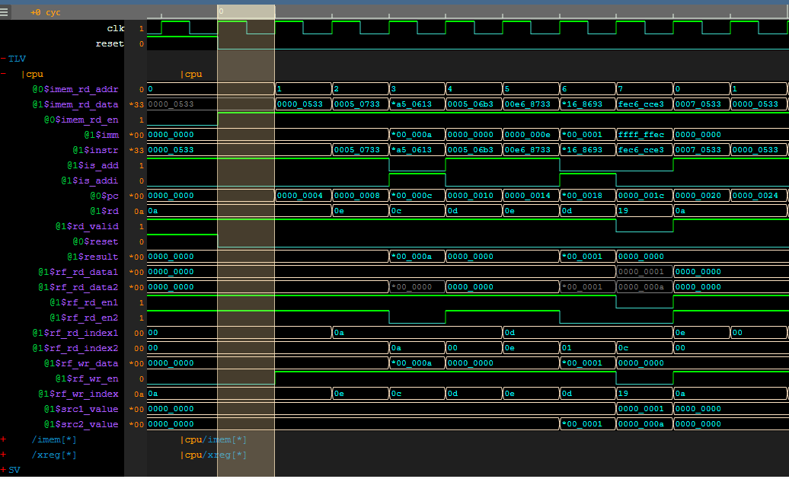
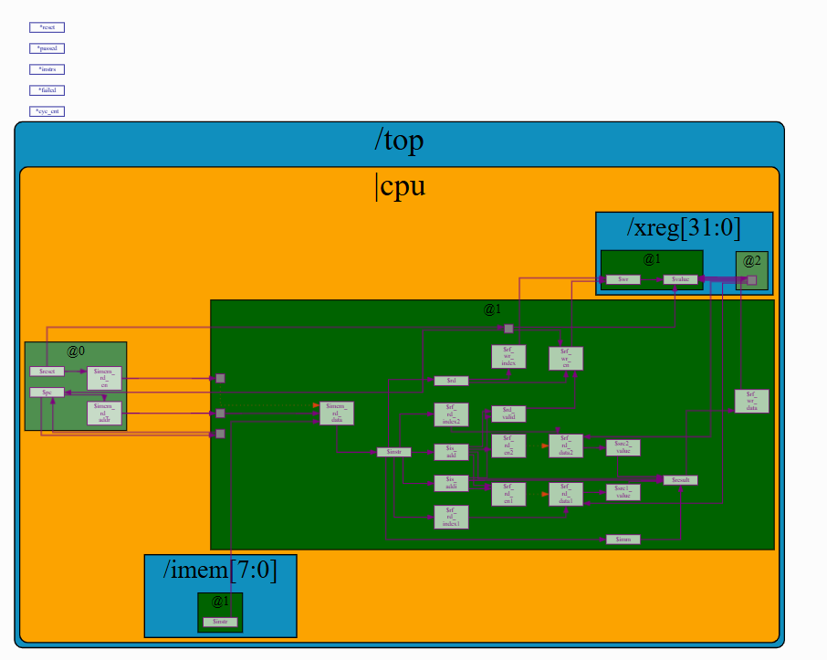

# 26-D4SK3_L1_Register_file_write

## Overview

The result of an instruction is written back to its destination register.

---

## Key Concepts

Writing is enabled only when:
- the instruction is valid,
- it has a destination register, and
- the destination is not `x0`.

Stores and conditional branches have no destination register. Writes to `x0` must have no effect, so that it always reads as zero. A register file is an array: the write index chooses which entry changes, while the other entries keep their values.

---

## My Lab Work and Results

The ALU `$result` is now written to `$rd`. Writes to `x0` are disabled.

Code: [lec26_rf_write.tlv](../src/lec26_rf_write.tlv)

### Register write logic

```tlv
$rd_valid = $is_add || $is_addi;

$rf_wr_en         = $rd_valid && $rd != 5'b0 && ! $reset;
$rf_wr_index[4:0] = $rd;
$rf_wr_data[31:0] = $result;
```

### Full TL-Verilog code

```tlv
\m4_TLV_version 1d: tl-x.org
\SV
   // This code can be found in: https://github.com/stevehoover/RISC-V_MYTH_Workshop

   m4_include_lib(['https://raw.githubusercontent.com/BalaDhinesh/RISC-V_MYTH_Workshop/master/tlv_lib/risc-v_shell_lib.tlv'])

\SV
   m4_makerchip_module   // (Expanded in Nav-TLV pane.)
\TLV

   // Test program: sum 1 to 9
   m4_asm(ADD, r10, r0, r0)             // Initialize r10 (a0) to 0.
   m4_asm(ADD, r14, r10, r0)            // Initialize sum register a4 with 0x0
   m4_asm(ADDI, r12, r10, 1010)         // Store count of 10 in register a2.
   m4_asm(ADD, r13, r10, r0)            // Initialize intermediate sum register a3 with 0
   m4_asm(ADD, r14, r13, r14)           // Incremental addition
   m4_asm(ADDI, r13, r13, 1)            // Increment intermediate register by 1
   m4_asm(BLT, r13, r12, 1111111111000) // If a3 is less than a2, branch to label named <loop>
   m4_asm(ADD, r10, r14, r0)            // Store final result to register a0 so that it can be read by main program

   m4_define_hier(['M4_IMEM'], M4_NUM_INSTRS)

   |cpu
      @0
         $reset = *reset;

         // Program counter: byte address
         $pc[31:0] = >>1$reset ? 32'd0 : >>1$pc + 32'd4;

         // Instruction memory interface
         $imem_rd_en = ! $reset;
         $imem_rd_addr[M4_IMEM_INDEX_CNT-1:0] = $pc[M4_IMEM_INDEX_CNT+1:2];

      @1
         $instr[31:0] = $imem_rd_data[31:0];

         // Decode ADD and ADDI
         $is_add  = $instr[6:0] == 7'b0110011 && $instr[14:12] == 3'b000 && $instr[31:25] == 7'b0000000;
         $is_addi = $instr[6:0] == 7'b0010011 && $instr[14:12] == 3'b000;

         $rd[4:0]   = $instr[11:7];
         $imm[31:0] = {{21{$instr[31]}}, $instr[30:20]};

         // Register file read
         $rf_rd_en1         = $is_add || $is_addi;
         $rf_rd_index1[4:0] = $instr[19:15];
         $rf_rd_en2         = $is_add;
         $rf_rd_index2[4:0] = $instr[24:20];

         $src1_value[31:0] = $rf_rd_data1;
         $src2_value[31:0] = $rf_rd_data2;

         // ALU
         $result[31:0] = $is_addi ? $src1_value + $imm :
                         $is_add  ? $src1_value + $src2_value :
                                    32'bx;

         // Only ADD and ADDI have a destination register here
         $rd_valid = $is_add || $is_addi;

         // Register file write: x0 is never written
         $rf_wr_en         = $rd_valid && $rd != 5'b0 && ! $reset;
         $rf_wr_index[4:0] = $rd;
         $rf_wr_data[31:0] = $result;


   // Assert these to end simulation (before Makerchip cycle limit).
   *passed = *cyc_cnt > 40;
   *failed = 1'b0;

   // Macro instantiations for:
   //  o instruction memory
   //  o register file
   //  o data memory
   //  o CPU visualization
   |cpu
      m4+imem(@1)    // Args: (read stage)
      m4+rf(@1, @1)  // Args: (read stage, write stage) - if equal, no register bypass is required
      //m4+dmem(@4)    // Args: (read/write stage)

   //m4+cpu_viz(@4)    // For visualisation, argument should be at least equal to the last stage of CPU logic. @4 would work for all labs.
\SV
   endmodule
```

### Waveform



| `$instr` | Instruction | `$result` | `$rf_wr_index` | `$rf_wr_en` |
|---|---|---|---|---|
| `00000533` | `add x10, x0, x0` | `00000000` | `0a` | 1 |
| `00050733` | `add x14, x10, x0` | `00000000` | `0e` | 1 |
| `00a50613` | `addi x12, x10, 10` | `0000000a` | `0c` | 1 |
| `00168693` | `addi x13, x13, 1` | `00000001` | `0d` | 1 |
| `fec6cce3` | `blt x13, x12, -8` | not used | not used | 0 |

**Write followed by read:** each register initially holds its own number, so `x10` starts at 10. The first instruction writes 0 to `x10`, and the next one reads `$src1_value = 00000000`. Similarly, `add x14, x13, x14` reads 0 from both registers instead of their initial values, 13 and 14.

`blt` has no destination register, so `$rd_valid` and `$rf_wr_en` are 0. Branching is not added yet, so the program does not loop back at this instruction.

**`x0` test:** Pending. The instructions in this waveform do not try to write to `x0`.

### Makerchip diagram



---

## Summary

- An incorrect write enable can silently corrupt registers.
