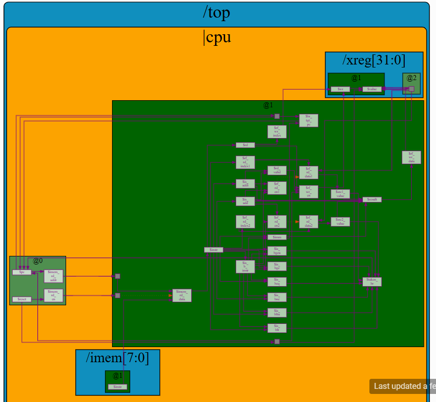

# 27-D4SK3_L2_Branch_instructions

## Overview

A conditional branch changes the PC only when its comparison is true.

---

## Key Concepts

| Instruction | Taken when |
|---|---|
| `beq` | operands are equal |
| `bne` | operands differ |
| `blt` | first is less than second, signed |
| `bge` | first is greater than or equal, signed |
| `bltu` | first is less than second, unsigned |
| `bgeu` | first is greater than or equal, unsigned |

The target is *branch instruction PC + sign-extended B immediate*. If the branch is not taken, execution continues at PC + 4.

---

## My Lab Work and Results

`$taken_br` is set according to the branch type and defaults to 0. When it is 1, the next PC is `$br_tgt_pc`; otherwise it is PC + 4.

Code: [lec27_branches.tlv](../src/lec27_branches.tlv)

### Branch logic

```tlv
$taken_br = $is_beq  ? ($src1_value == $src2_value) :
            $is_bne  ? ($src1_value != $src2_value) :
            $is_blt  ? ($src1_value <  $src2_value) ^ ($src1_value[31] != $src2_value[31]) :
            $is_bge  ? ($src1_value >= $src2_value) ^ ($src1_value[31] != $src2_value[31]) :
            $is_bltu ? ($src1_value <  $src2_value) :
            $is_bgeu ? ($src1_value >= $src2_value) :
                       1'b0;

$br_tgt_pc[31:0] = $pc + $imm;
```

PC selection:

```tlv
$pc[31:0] = >>1$reset    ? 32'd0 :
            >>1$taken_br ? >>1$br_tgt_pc :
                           >>1$pc + 32'd4;
```

### Waveform: before the first branch


The first six instructions are not branches, so `$is_b_instr` and `$taken_br` stay 0. The PC increases by 4 from `0x00` to `0x18`.

| `$instr` | Instruction | `$result` | `$taken_br` |
|---|---|---|---|
| `00000533` | `add x10, x0, x0` | `00000000` | 0 |
| `00050733` | `add x14, x10, x0` | `00000000` | 0 |
| `00a50613` | `addi x12, x10, 10` | `0000000a` | 0 |
| `000506b3` | `add x13, x10, x0` | `00000000` | 0 |
| `00e68733` | `add x14, x13, x14` | `00000000` | 0 |
| `00168693` | `addi x13, x13, 1` | `00000001` | 0 |

`$br_tgt_pc` is calculated for every instruction, but it is only used when `$taken_br` is 1.

**Taken and not-taken `blt`:** Pending.

### Makerchip diagram



---

## Summary

- Signed and unsigned comparisons can give different answers.
