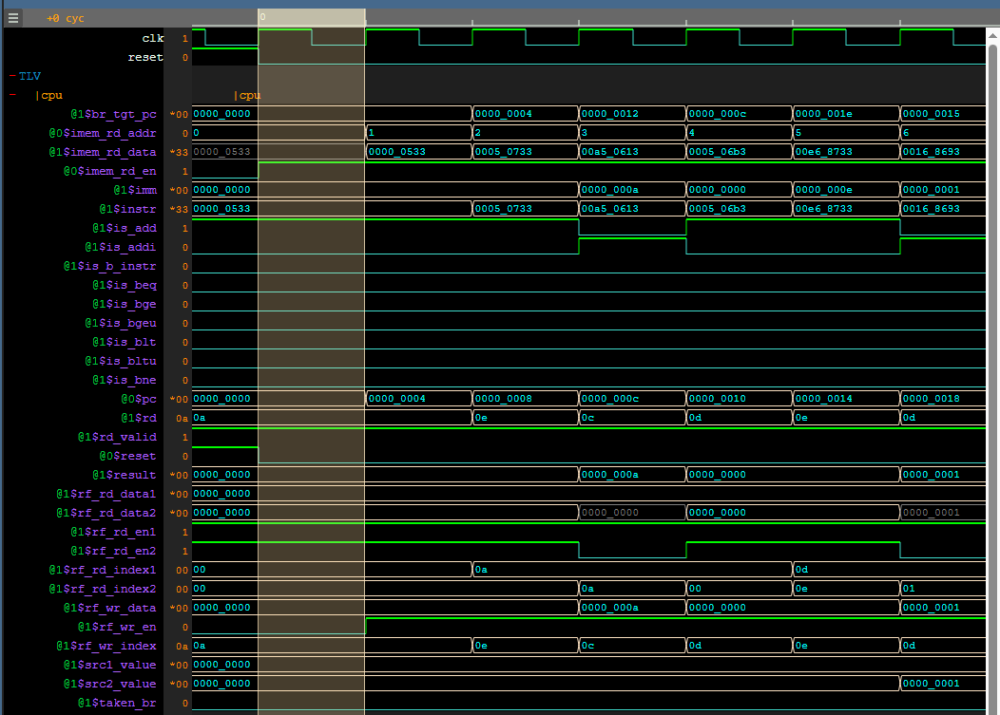

# 27-D4SK3_L2_Branch_instructions

## Overview

A conditional branch changes the PC only when its comparison is true.

---

## Key Concepts

| Instruction | Taken when |
|---|---|
| `beq` | operands are equal |
| `bne` | operands differ |
| `blt` | first is less than second, signed |
| `bge` | first is greater than or equal, signed |
| `bltu` | first is less than second, unsigned |
| `bgeu` | first is greater than or equal, unsigned |

The target is *branch instruction PC + sign-extended B immediate*. If the branch is not taken, execution continues at PC + 4.

---

## My Lab Work and Results

`$taken_br` is set according to the branch type and defaults to 0. When it is 1, the next PC is `$br_tgt_pc`; otherwise it is PC + 4.

Code: [lec27_branches.tlv](../src/lec27_branches.tlv)

### Branch logic

```tlv
$taken_br = $is_beq  ? ($src1_value == $src2_value) :
            $is_bne  ? ($src1_value != $src2_value) :
            $is_blt  ? ($src1_value <  $src2_value) ^ ($src1_value[31] != $src2_value[31]) :
            $is_bge  ? ($src1_value >= $src2_value) ^ ($src1_value[31] != $src2_value[31]) :
            $is_bltu ? ($src1_value <  $src2_value) :
            $is_bgeu ? ($src1_value >= $src2_value) :
                       1'b0;

$br_tgt_pc[31:0] = $pc + $imm;
```

PC selection:

```tlv
$pc[31:0] = >>1$reset    ? 32'd0 :
            >>1$taken_br ? >>1$br_tgt_pc :
                           >>1$pc + 32'd4;
```

### Full TL-Verilog code

```tlv
\m4_TLV_version 1d: tl-x.org
\SV
   // This code can be found in: https://github.com/stevehoover/RISC-V_MYTH_Workshop

   m4_include_lib(['https://raw.githubusercontent.com/BalaDhinesh/RISC-V_MYTH_Workshop/master/tlv_lib/risc-v_shell_lib.tlv'])

\SV
   m4_makerchip_module   // (Expanded in Nav-TLV pane.)
\TLV

   // Test program: sum 1 to 9
   m4_asm(ADD, r10, r0, r0)             // Initialize r10 (a0) to 0.
   m4_asm(ADD, r14, r10, r0)            // Initialize sum register a4 with 0x0
   m4_asm(ADDI, r12, r10, 1010)         // Store count of 10 in register a2.
   m4_asm(ADD, r13, r10, r0)            // Initialize intermediate sum register a3 with 0
   m4_asm(ADD, r14, r13, r14)           // Incremental addition
   m4_asm(ADDI, r13, r13, 1)            // Increment intermediate register by 1
   m4_asm(BLT, r13, r12, 1111111111000) // If a3 is less than a2, branch to label named <loop>
   m4_asm(ADD, r10, r14, r0)            // Store final result to register a0 so that it can be read by main program

   m4_define_hier(['M4_IMEM'], M4_NUM_INSTRS)

   |cpu
      @0
         $reset = *reset;

         // Program counter: byte address
         $pc[31:0] = >>1$reset    ? 32'd0 :
                     >>1$taken_br ? >>1$br_tgt_pc :
                                    >>1$pc + 32'd4;

         // Instruction memory interface
         $imem_rd_en = ! $reset;
         $imem_rd_addr[M4_IMEM_INDEX_CNT-1:0] = $pc[M4_IMEM_INDEX_CNT+1:2];

      @1
         $instr[31:0] = $imem_rd_data[31:0];

         // Decode ADD and ADDI
         $is_add  = $instr[6:0] == 7'b0110011 && $instr[14:12] == 3'b000 && $instr[31:25] == 7'b0000000;
         $is_addi = $instr[6:0] == 7'b0010011 && $instr[14:12] == 3'b000;

         // Decode branches
         $is_b_instr = $instr[6:0] == 7'b1100011;
         $is_beq     = $is_b_instr && $instr[14:12] == 3'b000;
         $is_bne     = $is_b_instr && $instr[14:12] == 3'b001;
         $is_blt     = $is_b_instr && $instr[14:12] == 3'b100;
         $is_bge     = $is_b_instr && $instr[14:12] == 3'b101;
         $is_bltu    = $is_b_instr && $instr[14:12] == 3'b110;
         $is_bgeu    = $is_b_instr && $instr[14:12] == 3'b111;

         $rd[4:0]   = $instr[11:7];
         $imm[31:0] = $is_b_instr ? {{20{$instr[31]}}, $instr[7], $instr[30:25], $instr[11:8], 1'b0} :
                                    {{21{$instr[31]}}, $instr[30:20]};

         // Register file read
         $rf_rd_en1         = $is_add || $is_addi || $is_b_instr;
         $rf_rd_index1[4:0] = $instr[19:15];
         $rf_rd_en2         = $is_add || $is_b_instr;
         $rf_rd_index2[4:0] = $instr[24:20];

         $src1_value[31:0] = $rf_rd_data1;
         $src2_value[31:0] = $rf_rd_data2;

         // ALU
         $result[31:0] = $is_addi ? $src1_value + $imm :
                         $is_add  ? $src1_value + $src2_value :
                                    32'bx;

         // Only ADD and ADDI have a destination register here
         $rd_valid = $is_add || $is_addi;

         // Register file write: x0 is never written
         $rf_wr_en         = $rd_valid && $rd != 5'b0 && ! $reset;
         $rf_wr_index[4:0] = $rd;
         $rf_wr_data[31:0] = $result;

         // Branch decision
         $taken_br = $is_beq  ? ($src1_value == $src2_value) :
                     $is_bne  ? ($src1_value != $src2_value) :
                     $is_blt  ? ($src1_value <  $src2_value) ^ ($src1_value[31] != $src2_value[31]) :
                     $is_bge  ? ($src1_value >= $src2_value) ^ ($src1_value[31] != $src2_value[31]) :
                     $is_bltu ? ($src1_value <  $src2_value) :
                     $is_bgeu ? ($src1_value >= $src2_value) :
                                1'b0;

         // Branch target
         $br_tgt_pc[31:0] = $pc + $imm;

   // Assert these to end simulation (before Makerchip cycle limit).
   *passed = *cyc_cnt > 55;
   *failed = 1'b0;

   // Macro instantiations for:
   //  o instruction memory
   //  o register file
   //  o data memory
   //  o CPU visualization
   |cpu
      m4+imem(@1)    // Args: (read stage)
      m4+rf(@1, @1)  // Args: (read stage, write stage) - if equal, no register bypass is required
      //m4+dmem(@4)    // Args: (read/write stage)

   //m4+cpu_viz(@4)    // For visualisation, argument should be at least equal to the last stage of CPU logic. @4 would work for all labs.
\SV
   endmodule
```

### Waveform: before the first branch



The first six instructions are not branches, so `$is_b_instr` and `$taken_br` stay 0. The PC increases by 4 from `0x00` to `0x18`.

| `$instr` | Instruction | `$result` | `$taken_br` |
|---|---|---|---|
| `00000533` | `add x10, x0, x0` | `00000000` | 0 |
| `00050733` | `add x14, x10, x0` | `00000000` | 0 |
| `00a50613` | `addi x12, x10, 10` | `0000000a` | 0 |
| `000506b3` | `add x13, x10, x0` | `00000000` | 0 |
| `00e68733` | `add x14, x13, x14` | `00000000` | 0 |
| `00168693` | `addi x13, x13, 1` | `00000001` | 0 |

`$br_tgt_pc` is calculated for every instruction, but it is only used when `$taken_br` is 1.

**Taken and not-taken `blt`:** Pending.

### Makerchip diagram


---

## Summary

- Signed and unsigned comparisons can give different answers.
