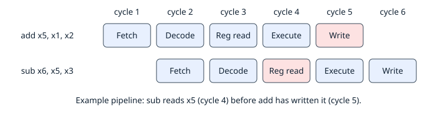
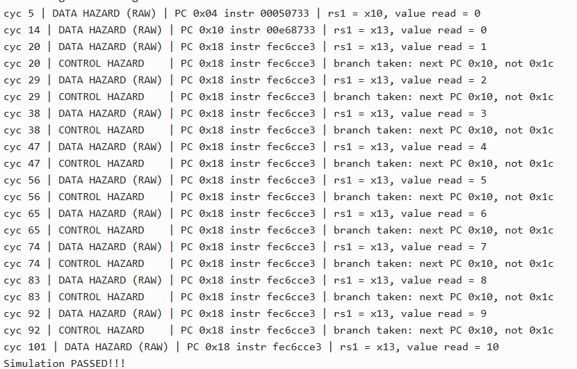

# 28-D5SK1_L1_Pipeline_hazards

## Overview

In a pipelined CPU, several instructions are in progress at once. A hazard occurs when one cannot safely proceed as planned.

---

## Key Concepts

- **Data hazard:** an instruction needs a result that is not yet available. In a **read-after-write** case, it reads a register that an earlier instruction has not yet written.
- **Control hazard:** the CPU fetches more instructions before it knows where a branch or jump goes.
- **Structural hazard:** two instructions need the same hardware at once.

Which hazards occur, and how many cycles they cost, depends on the pipeline design.

---

## My Lab Work and Results

### Data hazards: back-to-back pairs in my test program

| First instruction (writes) | Next instruction (reads) | Register |
|---|---|---|
| `0x00` `add x10, x0, x0` | `0x04` `add x14, x10, x0` | `x10` |
| `0x0C` `add x13, x10, x0` | `0x10` `add x14, x13, x14` | `x13` |
| `0x14` `addi x13, x13, 1` | `0x18` `blt x13, x12, -8` | `x13` |

These are read-after-write dependencies. The program also has dependencies between instructions that are farther apart.

### Control hazard

`0x18` `blt x13, x12, -8` decides whether the next instruction is at `0x10` (taken) or `0x1C` (not taken). The CPU does not know this when it would normally fetch the next instruction.

### Structural hazard

I did not identify one in this design. Instructions come from a separate instruction memory, and the register file has two read ports and one write port.

### Evidence from the 3-cycle CPU

The hazard messages from [lec30](30-D5SK1_L3_Hazard_solutions.md) report the same three data dependencies (PC `0x04`, `0x10` and `0x18`) and the taken branch at `0x18`.

In the 3-cycle CPU these cause no wrong result, because the next valid instruction starts three cycles later. The simulation passes.

### What changes with one instruction every cycle

This is the expected behaviour if registers are read in `@2` and written in `@3`, and branches redirect the PC from `@3`. I have not simulated this pipeline on this page.

| Hazard | Effect without handling | Handling |
|---|---|---|
| Data: the three pairs above | The second instruction reads the old register value | Register bypass |
| Control: taken `blt` | The next two fetched instructions (`0x1C` and `0x20`) are on the wrong path | Mark them invalid |

---

## Summary

- Pipelining creates overlap, and overlap creates dependencies.
