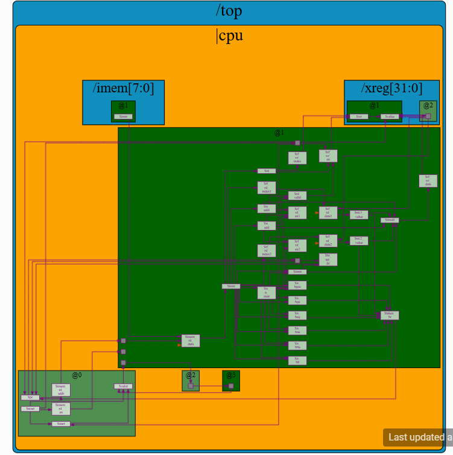

# 29-D5SK1_L2_Valid_signal_and_pipeline_stages

## Overview

A good way to build a pipeline is to first make it work with gaps, then place logic into stages.

---

## Key Concepts

Start by issuing one valid instruction every few cycles, for example every third cycle in a three-cycle loop. A one-cycle start pulse after reset can circulate through two flip-flop delays to create this pattern.

Invalid cycles must not change state, so use the valid signal to control:
- register writes,
- memory writes, and
- PC redirects.

Once this works, distribute fetch, decode, register read, execute and write-back across stages. Later, increase the issue rate to every cycle and handle the hazards that appear.

---

## My Lab Work and Results

`$start` gives the first `$valid` pulse after reset. `>>3$valid` then repeats the pulse every third cycle. `$valid` does not control the CPU yet.

Code: [lec29_valid3.tlv](../src/lec29_valid3.tlv)

### Valid logic

```tlv
$start = >>1$reset && ! $reset;

$valid = $reset ? 1'b0 :
         $start ? 1'b1 :
                  >>3$valid;
```

### Stage assignment

| Stage | Logic in this version |
|---|---|
| `@0` | Reset, `$start`, `$valid`, PC and instruction memory address |
| `@1` | Instruction read, decode, register read and write, ALU and branch logic |

### Makerchip diagram



### Valid waveform

Pending.

---

## Summary

- Change one thing at a time and keep the test passing.
