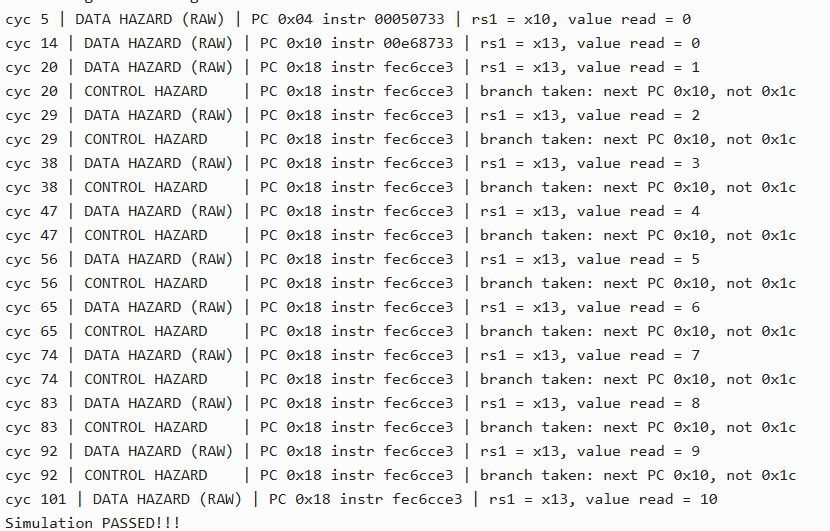
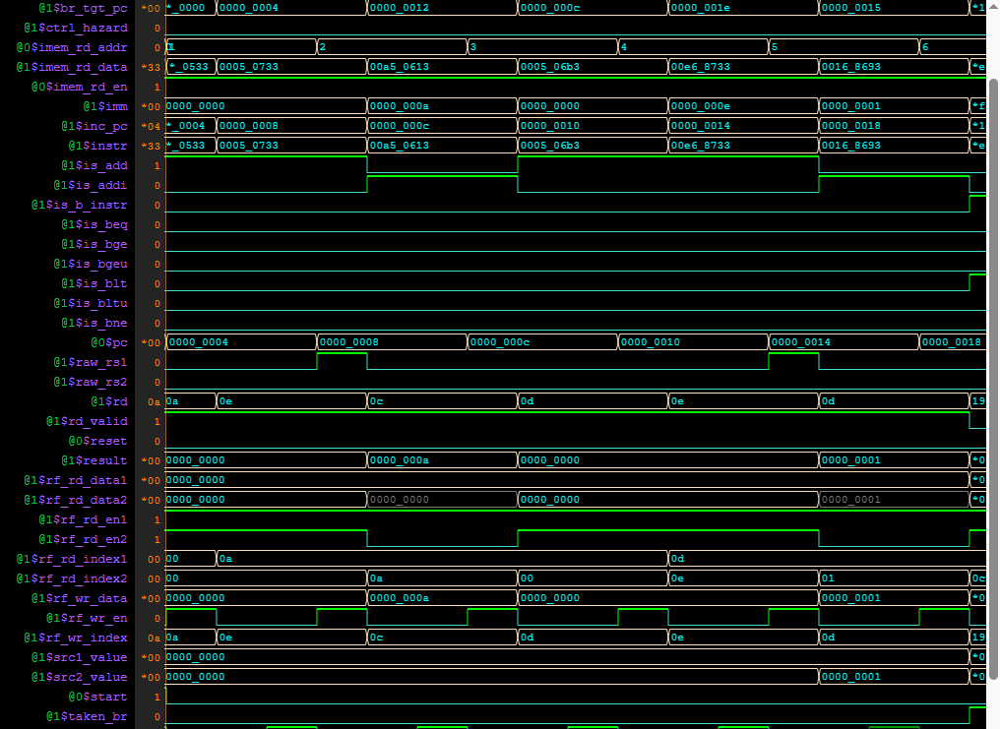
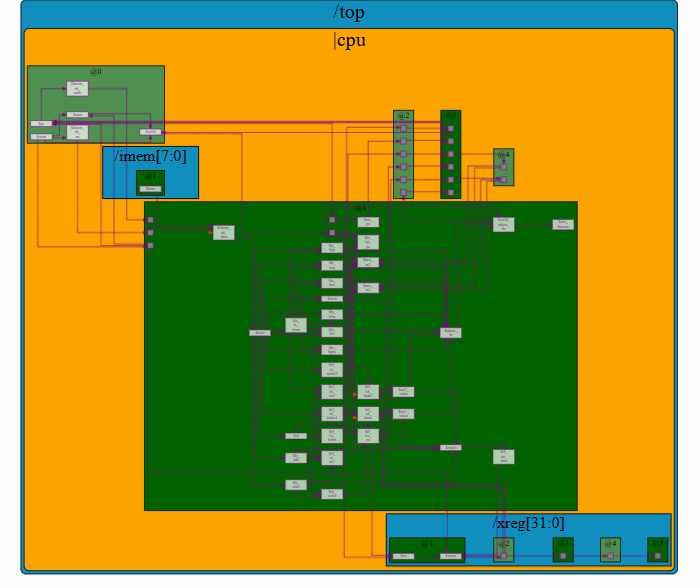

# 30-D5SK1_L3_Hazard_solutions

## Overview

The usual solutions are to wait, to forward results or to cancel wrong instructions.

---

## Key Concepts

- **Stall:** hold a dependent instruction until its data is ready.
- **Register bypass (forwarding):** if an earlier instruction is writing the register now being read, send the ALU result directly to the operand. The check needs a valid register write and matching register numbers.
- **Branch squash:** continue fetching in sequence, and if a branch is taken, redirect the PC and mark the wrong-path instructions invalid.

The number of earlier cycles to check or cancel follows from the stage in which each result becomes available.

---

## My Lab Work and Results

### 3-cycle RISC-V CPU

The CPU issues one valid instruction every three cycles and runs the program that adds 1 to 9.

Code: [lec30_hazard_print.tlv](../src/lec30_hazard_print.tlv)

- Only valid instructions write registers: `$rf_wr_en = $valid && $rd_valid && $rd != 5'b0;`
- Only a valid branch redirects the PC: `$valid_taken_br = $valid && $taken_br;`
- The PC takes its values from the previous valid instruction with `>>3`.

**Result:** the simulation **passed**. The pass condition checks that `x10` equals 45.

### Hazard detection

Each check compares the current instruction with the previous valid instruction.

```tlv
$raw_rs1 = $valid && >>3$rf_wr_en && $rf_rd_en1 && ($rf_rd_index1 == >>3$rf_wr_index);
$raw_rs2 = $valid && >>3$rf_wr_en && $rf_rd_en2 && ($rf_rd_index2 == >>3$rf_wr_index);
$ctrl_hazard = $valid_taken_br;
```

`$display` inside `\SV_plus` prints the PC, instruction and details in the Makerchip Log.

### Simulation log



| Hazard | PC | Messages | What it shows |
|---|---|---|---|
| Data (RAW) | `0x04` | 1 | Reads `x10`, written by the previous instruction |
| Data (RAW) | `0x10` | 1 | Reads `x13`, written by the previous instruction |
| Data (RAW) | `0x18` | 10 | `blt` reads `x13` just after `addi` updates it (values 1 to 10) |
| Control | `0x18` | 9 | Branch taken: next PC is `0x10`, not `0x1c` |

There are 12 data-hazard and 9 control-hazard messages. The last `blt` is not taken, so it has no control-hazard message. No `rs2` data hazard was reported.

These messages mark dependencies and taken branches. In this 3-cycle CPU they do not cause a wrong result: the values read are up to date, and the program passes. They need handling, such as register bypass and branch squash, when an instruction is issued every cycle.

### Waveform



In this early part of the run, `$raw_rs1` pulses for the instructions at PC `0x04` (`00050733`) and `0x10` (`00e68733`). `$rf_wr_en` is high for one cycle in three.

**Taken-branch waveform:** Pending. This view ends before the first taken branch.

### Makerchip diagram



---

## Summary

- A cancelled instruction must not change registers, memory or the PC.
