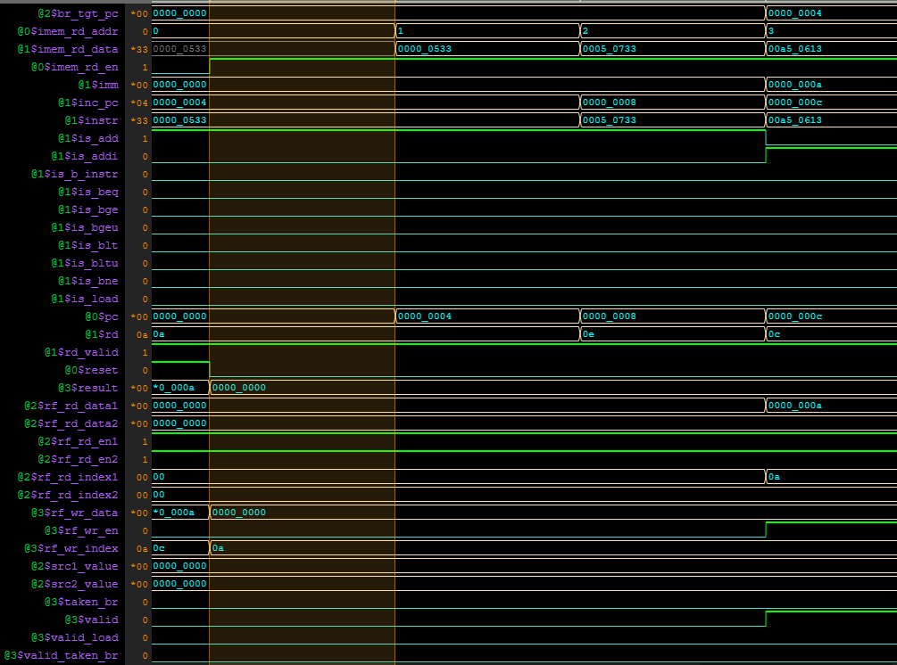
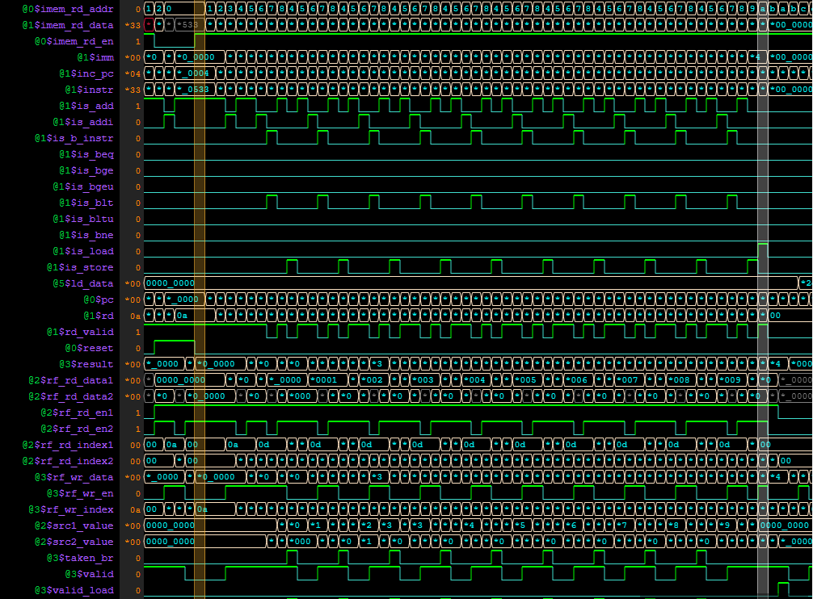
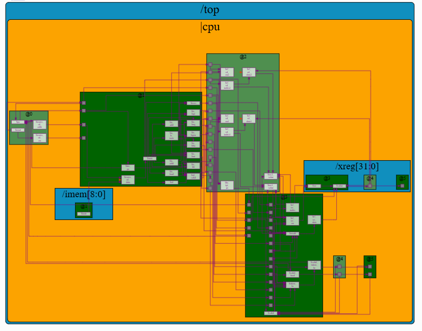

# 31-D5SK2_L1_Load_redirect

## Overview

A load's data arrives later than an ALU result, so the following instructions may not be able to use it in time.

---

## Key Concepts

One simple solution is a **redirect and replay**:
1. Detect a valid load.
2. Mark the instructions in its shadow as invalid.
3. Fetch again from the instruction after the load, once the pipeline can safely continue.
4. Write the loaded data into the load's destination register when it arrives.

The destination register number must travel with the load, or be taken from the correct earlier stage. The write path then selects between ALU data and load data.

---

## My Lab Work and Results

The CPU now starts an instruction every cycle, with logic in `@1`, `@2` and `@3` and register bypass. The two instructions after a load are marked invalid, and the PC returns to the instruction after the load. A test load, `lw x15, 4(x0)`, was added before the final `add`. Load data is not written to `x15` yet.

Code: [lec31_load_redirect.tlv](../src/lec31_load_redirect.tlv)

### Load redirect logic

```tlv
$valid = ! $reset &&
         ! (>>1$valid_taken_br || >>2$valid_taken_br ||
            >>1$valid_load     || >>2$valid_load);

$valid_load = $valid && $is_load;
```

PC selection:

```tlv
$pc[31:0] = >>1$reset          ? 32'd0 :
            >>3$valid_taken_br ? >>3$br_tgt_pc :
            >>3$valid_load     ? >>3$inc_pc :
                                 >>1$inc_pc;
```

### Waveform: start of the run



Cycle 0 is the first cycle after reset.

| Observation | Waveform |
|---|---|
| An instruction is fetched every cycle | `@0$pc` is `0x00`, `0x04`, `0x08`, `0x0C` in cycles 0 to 3 |
| The first instruction reaches `@3` in cycle 3 | `@3$valid = 1`, `@3$rf_wr_en = 1`, index `0a`, result 0 |
| Register bypass works | In cycle 3, `@2$rf_rd_data1 = 0000000a` but `@2$src1_value = 00000000` |

In cycle 3, `add x14, x10, x0` reads `x10` while the previous instruction is writing 0 to it. The register file still gives the old value, 10. The bypass supplies the new value, 0.

### Waveform: load shadow



This waveform comes from the later [lec32 code](../src/lec32_load_store.tlv). It adds a store and data memory, and its load is at PC `0x24`. It uses the same `$valid` and `$valid_load` logic.

At the right end of the waveform:

| Observation | Waveform |
|---|---|
| A valid load reaches `@3` | `@3$valid_load` is 1 for one cycle |
| The two instructions after the load are cancelled | `@3$valid` is 0 for the next two cycles |
| Valid instructions resume | `@3$valid` returns to 1 after those two cycles |

**PC value during the redirect and simulation log:** Pending. The PC values cannot be read at this zoom level.

### Makerchip diagram



---

## Summary

- The length of the load shadow depends on your pipeline.
