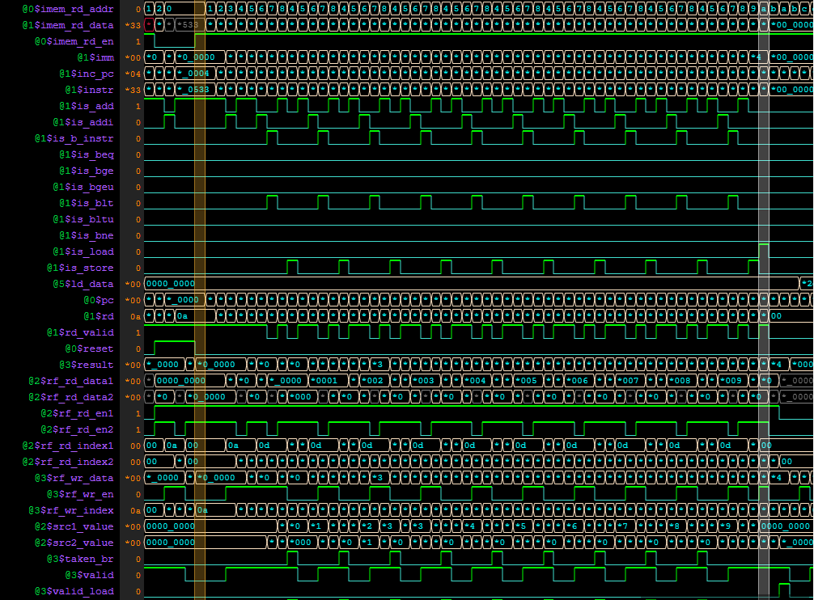
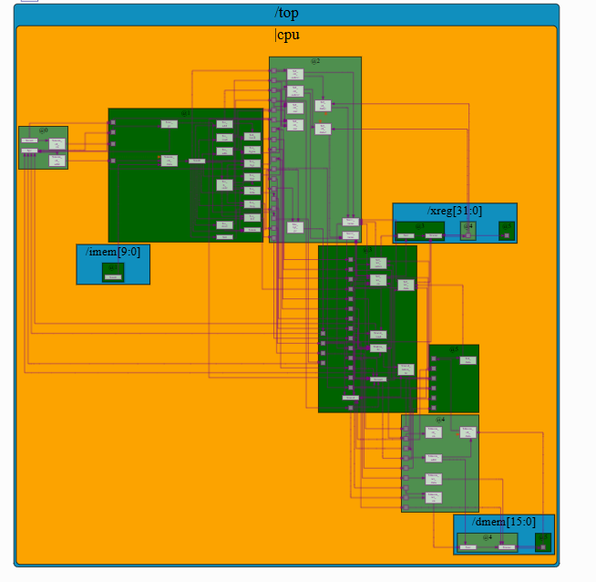

# 32-D5SK2_L2_Data_memory_with_loads_and_stores

## Overview

Data memory is accessed by loads and stores.

---

## Key Concepts

For both, the address is:

```text
address = rs1 value + sign-extended immediate
```

| Signal | Load | Store |
|---|---|---|
| Read enable | On for a valid load | Off |
| Write enable | Off | On for a valid store |
| Write data | Not used | rs2 value |

A word-indexed memory uses the address bits above the lowest two. A simple test stores a result, loads it into another register and checks that the two match.

A teaching CPU may treat every load and store as a word. Full RV32I also defines byte and halfword accesses.

---

## My Lab Work and Results

The test program now stores the final result at address 4 and loads it into `x15`. The pass condition checks `x15`.

Code: [lec32_load_store.tlv](../src/lec32_load_store.tlv)

### Program and pass condition

```tlv
m4_asm(ADD, r10, r14, r0)     // final result in x10
m4_asm(SW, r0, r10, 100)      // store x10 at address 4
m4_asm(LW, r15, r0, 100)      // load address 4 into x15

*passed = |cpu/xreg[15]>>5$value == (1+2+3+4+5+6+7+8+9);
```

### Data memory and load write-back

```tlv
@4
   $dmem_wr_en         = $valid && $is_store;
   $dmem_rd_en         = $valid_load;
   $dmem_addr[3:0]     = $result[5:2];
   $dmem_wr_data[31:0] = $src2_value;
@5
   $ld_data[31:0] = $dmem_rd_data;
```

```tlv
// in @3
$rf_wr_en         = ($valid && $rd_valid && ! $is_load && $rd != 5'b0) ||
                    (>>2$valid_load && >>2$rd != 5'b0);
$rf_wr_index[4:0] = >>2$valid_load ? >>2$rd      : $rd;
$rf_wr_data[31:0] = >>2$valid_load ? >>2$ld_data : $result;
```

### Waveform



At the right end of the waveform, after the last loop pass:

| Observation | What it shows |
|---|---|
| `@1$is_store` pulses, then `@1$is_load` in the next cycle | The store and then the load are decoded |
| `@3$valid_load` pulses once | One valid load reaches `@3` |
| `@3$valid` is 0 for the next two cycles | The load shadow is cancelled |
| `@5$ld_data` changes two cycles after `@3$valid_load` | Data arrives from memory in `@5` |
| `@3$rf_wr_en` is 1 in that same cycle, while `@3$valid` is 0 | The loaded data is written back during the shadow |

Earlier `@1$is_store` pulses appear during the loop. These are instructions fetched after the branch, before it redirects the PC.

**Values of 45 (`0x2d`) in the store, `$ld_data` and `x15`:** Pending. They are shortened or out of view at this zoom level.

**Simulation log:** Pending.

### Makerchip diagram



---

## Summary

- Memory enables must include the valid signal.
