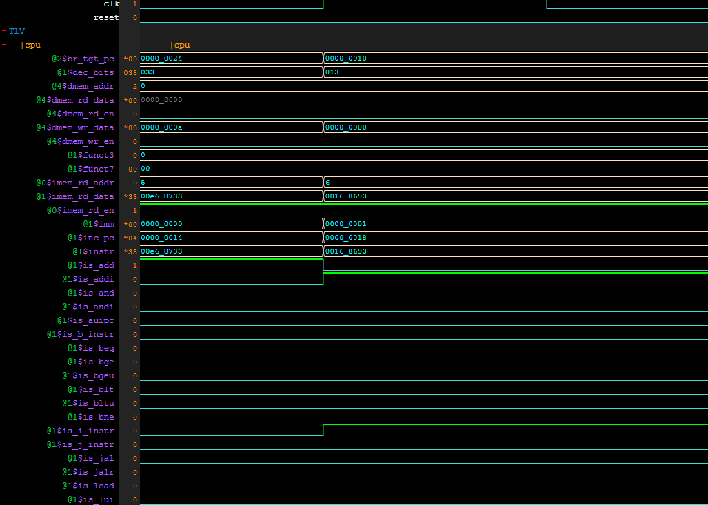
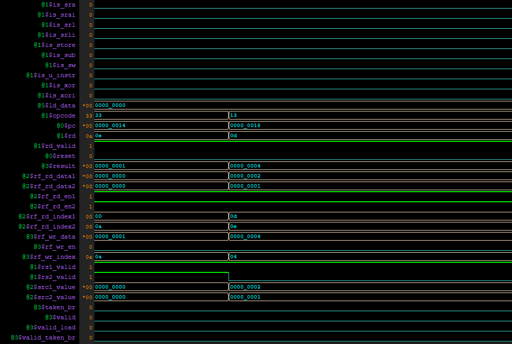
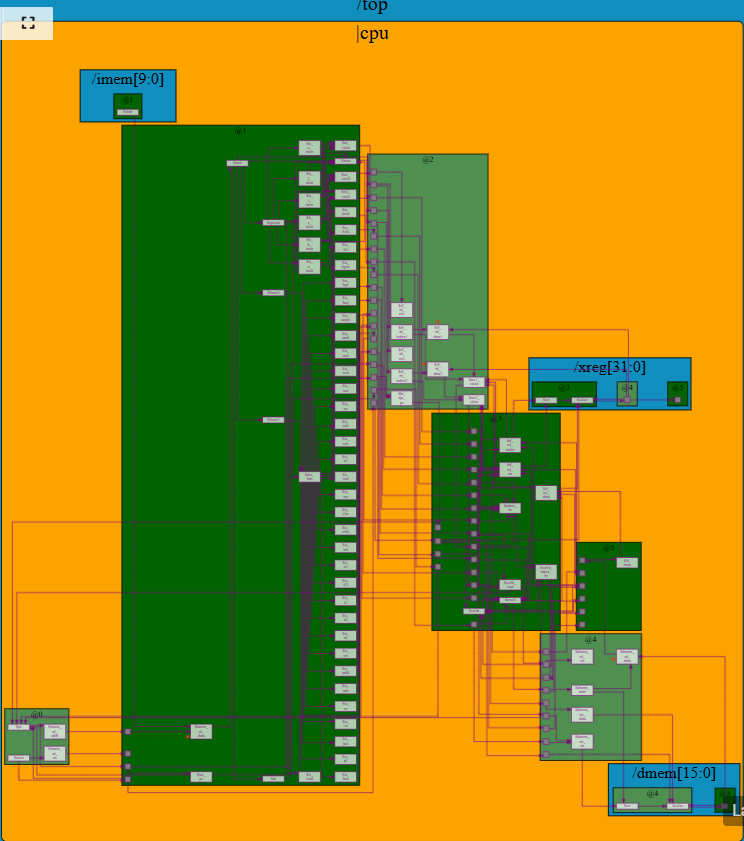

# 33-D5SK3_L1_Complete_decode_and_ALU

## Overview

After the first instructions work, the decoder and ALU are extended to the rest of the integer set.

---

## Key Concepts

| Group | RV32I instructions |
|---|---|
| Arithmetic | `add`, `addi`, `sub` |
| Logical | `and`, `andi`, `or`, `ori`, `xor`, `xori` |
| Shifts | `sll`, `slli`, `srl`, `srli`, `sra`, `srai` |
| Comparisons | `slt`, `slti`, `sltu`, `sltiu` |
| Upper immediate | `lui`, `auipc` |
| Jumps | `jal`, `jalr` |

- Register shifts use only the lowest 5 bits of the second operand.
- `sra` keeps the sign bit; `srl` fills with zeros.
- `sltiu` sign-extends its immediate, then compares as unsigned.

`fence`, `ecall` and `ebreak` are also in RV32I. A teaching core may leave them out; state this if yours does.

---

## My Lab Work and Results

The core now decodes the RV32I instructions below. All loads share one signal, `$is_load`, based on the opcode. `fence`, `ecall` and `ebreak` are not included.

Code: [lec33_full_decode.tlv](../src/lec33_full_decode.tlv)

### Decode logic

```tlv
$dec_bits[10:0] = {$funct7[5], $funct3, $opcode};

$is_beq  = $dec_bits ==? 11'bx_000_1100011;
$is_addi = $dec_bits ==? 11'bx_000_0010011;
$is_add  = $dec_bits ==? 11'b0_000_0110011;
$is_sub  = $dec_bits ==? 11'b1_000_0110011;

$is_load = $opcode == 7'b0000011;
```

`x` in a pattern means that the bit can be 0 or 1. `BOGUS_USE` quiets warnings for signals that are not used yet.

### Decoded and executed

| Instructions | Decoded | Executed by this code |
|---|---|---|
| `add`, `addi` | Yes | Yes |
| `beq`, `bne`, `blt`, `bge`, `bltu`, `bgeu` | Yes | Yes |
| Loads | Yes, as one group | Word load only |
| `sw` | Yes | Yes |
| `sb`, `sh` | Yes | Not yet: they would write a whole word |
| Other arithmetic, logic, shift and compare instructions | Yes | Not yet |
| `lui`, `auipc`, `jal`, `jalr` | Yes | Not yet |

"Yes" in the last column means the logic is in the code. The test program uses only `add`, `addi`, `blt`, `sw` and `lw`.

### Tests outside Makerchip

- A script applied the decode patterns to 37 assembled instructions. Each of the 32 non-load instructions matched only its own pattern, and the 5 loads matched none of them.
- 8 immediate values covering the I, S, B, U and J formats passed in a Verilog simulation.

### Makerchip waveform





The signals below are in `@1`.

| Signal | `add x14, x13, x14` | `addi x13, x13, 1` |
|---|---|---|
| `$instr` | `00e68733` | `00168693` |
| `$dec_bits` | `033` | `013` |
| Instruction flag | `$is_add = 1` | `$is_addi = 1` |
| `$is_i_instr` | 0 | 1 |
| `$rd` | `0e` | `0d` |
| `$rs1_valid`, `$rs2_valid` | 1, 1 | 1, 0 |
| `$imm` | `00000000` | `00000001` |

In the same two cycles, `@3$valid` and `@3$rf_wr_en` are 0. `@3` holds the instructions fetched after a taken branch: `add x10, x14, x0` (index `0a`, result 1), then `sw` (address 4). They are cancelled.

**Simulation log with the store, load and pass result:** Pending.

### Makerchip diagram



---

## Summary

- Decoding an instruction is not enough; test its result too.
