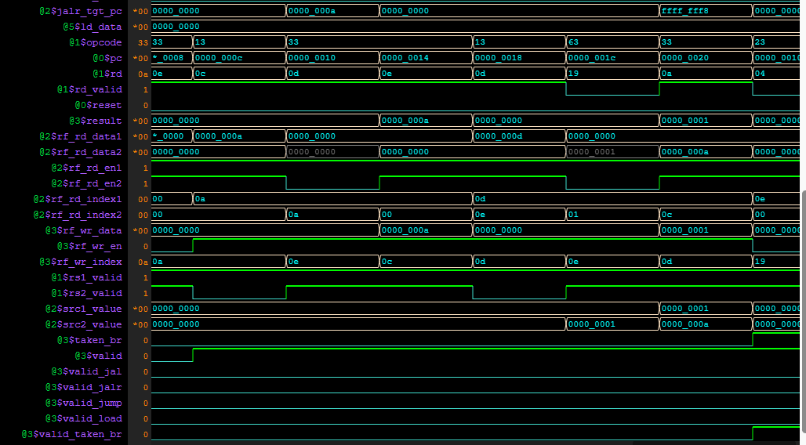
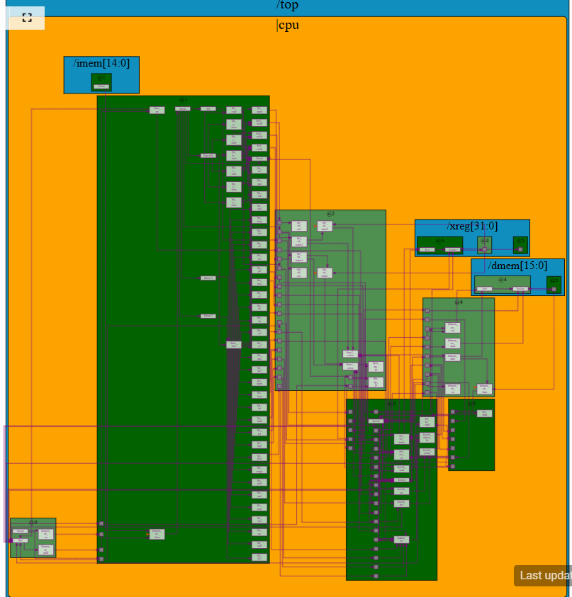

# 34-D5SK3_L2_Jump_instructions

## Overview

Jumps always change the flow of control.

---

## Key Concepts

| Instruction | Target | Value written to rd |
|---|---|---|
| `jal` | jump PC + J immediate | jump PC + 4 |
| `jalr` | (rs1 value + I immediate), with bit 0 cleared | jump PC + 4 |

In a pipeline, instructions fetched from the wrong path must be invalidated, as for a taken branch. `jalr` depends on a register, so it needs the correct (possibly bypassed) value. A function return, `ret`, is `jalr x0, 0(ra)`.

---

## My Lab Work and Results

I added `jal` and `jalr` control to the pipelined CPU. A jump redirects the PC, cancels the next two instructions and writes PC + 4 to `rd`.

Code: [lec34_jumps.tlv](../src/lec34_jumps.tlv)

### Jump logic

```tlv
// @2: targets
$br_tgt_pc[31:0]   = $pc + $imm;                               // branch and JAL
$jalr_tgt_pc[31:0] = ($src1_value + $imm) & 32'hFFFF_FFFE;     // JALR

// @3: only valid jumps count
$valid_jal  = $valid && $is_jal;
$valid_jalr = $valid && $is_jalr;
$valid_jump = $valid_jal || $valid_jalr;
```

`$valid` is 0 for the two instructions after a valid jump. The PC takes the jump target three cycles back (`>>3`), and `$result` is `$inc_pc` for a jump.

### Jump test program

| PC | Instruction | Expected behaviour |
|---|---|---|
| `0x28` | `jal x1, +8` | Goes to `0x30`, `x1 = 0x2C` |
| `0x30` | `jalr x2, 0(x1)` | Goes to `0x2C`, `x2 = 0x34` |
| `0x2C` | `jal x3, +12` | Goes to `0x38`, `x3 = 0x30` |
| `0x34` | `addi x15, x0, 0` | Must not run |
| `0x38` | `jal x0, 0` | Loops here |

In `m4_asm`, the `JAL` argument is half the byte offset. The pass condition checks `x1`, `x2`, `x3` and `x15 = 45`.

In a separate cycle model outside Makerchip, the program met the register conditions. With either the `jal` or `jalr` PC redirect turned off, it did not.

### Waveform: start of the run



The code runs in Makerchip. This view ends before the program reaches the jumps. Cycle 0 is the first cycle after reset.

| Observation | Waveform |
|---|---|
| The first instruction reaches `@3` | Cycle 3: `@3$valid = 1` |
| Register bypass | Cycle 3: `@2$rf_rd_data1 = 0000000a`, `@2$src1_value = 00000000` |
| First taken branch | Cycle 9: `@3$taken_br` and `@3$valid_taken_br` are 1 |
| Branch redirect | Cycle 9: `@0$pc = 00000010` |
| No jump yet | `$valid_jal`, `$valid_jalr` and `$valid_jump` are 0 |

**Jump waveform and simulation log:** Pending.

### Makerchip diagram



---

## Summary

- The link value lets a program return to the caller.
