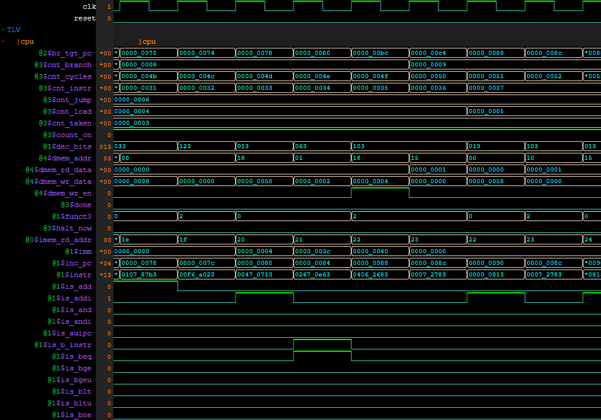
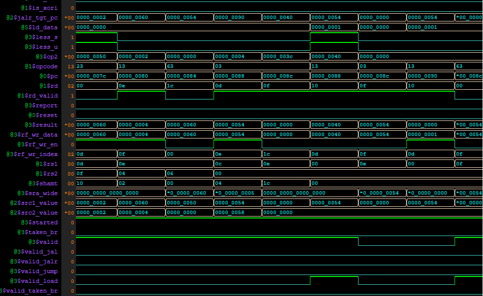
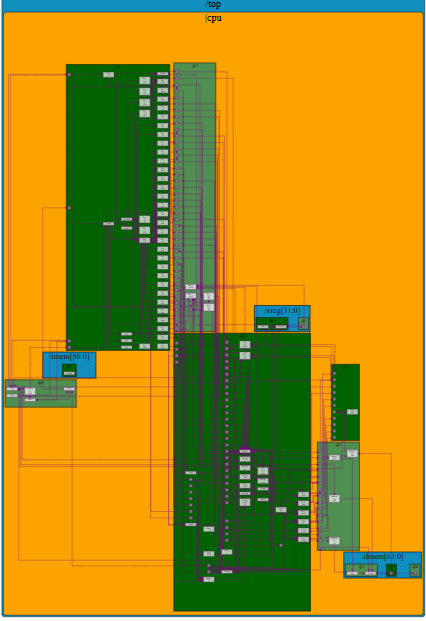
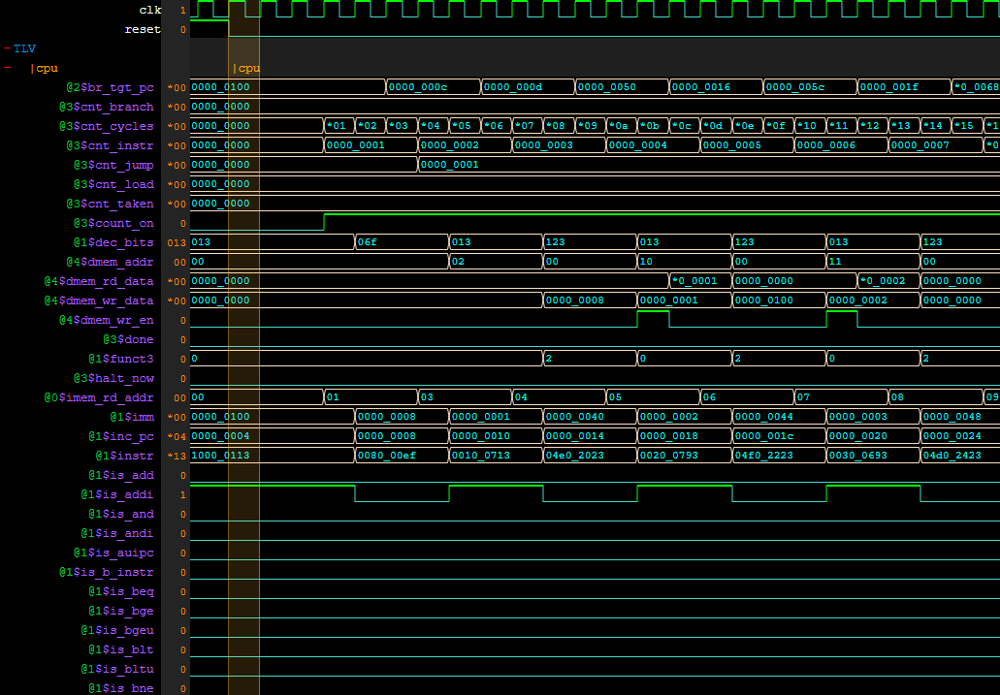

# GEMM on RVMYTH: Pipelined vs Non-Pipelined

Course project, **VSD RISC-V based MYTH Workshop**.

A 2x2 matrix multiply written in C is compiled to RV32I and run on two versions of my RVMYTH CPU. The project compares their latency and counts branch misses and penalty cycles.

## 1. Task

1. Write a C program for GEMM or convolution.
2. Compile it to RISC-V assembly.
3. Use the generated code as the test program for the RVMYTH CPU.
4. Compare pipelined and non-pipelined latency, and report branch misses and penalty cycles.

## 2. Program

[`c/gemm.c`](c/gemm.c) computes **C = A x B** (GEMM with alpha = 1 and beta = 0).

```
    A = | 1 2 |      B = | 2 1 |      C = |  4  5 |
        | 3 4 |          | 1 2 |          | 10 11 |
```

| Matrix | Data memory (byte addresses) |
|---|---|
| A | `0x40` - `0x4C` |
| B | `0x50` - `0x5C` |
| C | `0x60` - `0x6C` |

RV32I has no multiply instruction, so `soft_mul()` multiplies using shifts and adds. This adds branches, and their number depends on the values in B.

**Why 2x2:** a 3x3 version needed 1580 (pipelined) and 2994 (non-pipelined) cycles in Verilog simulation. A Makerchip run of the 3x3 version stopped at its cycle limit, which appeared to be about 600 cycles in the waveform. The 2x2 size and small values keep both runs below that.

## 3. Compile to assembly

```sh
riscv64-unknown-elf-gcc -march=rv32i -mabi=ilp32 -Os -ffreestanding -S c/gemm.c -o asm/gemm.s
sh scripts/build.sh          # assembly, disassembly and machine code
python3 scripts/make_tlv.py  # puts the machine code into both CPUs
```

Compiler used for the files here: GCC 13.2.0. `soft_mul()` is marked to be inlined, which avoids function-call overhead.

| File | Content |
|---|---|
| [`asm/gemm.s`](asm/gemm.s) | Assembly generated by GCC |
| [`asm/gemm.objdump.txt`](asm/gemm.objdump.txt) | Linked program with addresses |
| [`asm/gemm.hex`](asm/gemm.hex) | 52 machine-code words loaded into the CPU |


## 4. The two CPUs

| | Non-pipelined | Pipelined |
|---|---|---|
| New instruction | Every 3rd cycle | Every cycle |
| Instructions in flight | 1 | Several |
| Hazards | Previous instruction finishes first (load data is bypassed) | Register bypass; wrong-path instructions cancelled |
| Cost of a taken branch | No extra cycles | 2 cycles |
| File | [`tlv/rvmyth_nonpipelined.tlv`](tlv/rvmyth_nonpipelined.tlv) | [`tlv/rvmyth_pipelined.tlv`](tlv/rvmyth_pipelined.tlv) |

**What "non-pipelined" means here:** the same stages and datapath, but only one instruction at a time (the 3-cycle `$valid` method from the course). It is not a single-cycle CPU.

**Changes from my lab CPU:**

- ALU operations for the RV32I register and immediate arithmetic, logic, shift and compare instructions, plus `lui` and `auipc`
- Data memory increased to 64 words
- Instruction memory loaded with compiler-generated machine code
- Registers and data memory start at zero
- Hardware counters, and a log report showing inputs A and B, output C and the measurements

Only `lw` and `sw` are supported for memory access.

**Branch prediction:** there is no predictor. Fetch continues to the next address, which is the same as always predicting *not taken*. Every **taken** conditional branch is therefore a **miss**, and cancels the next 2 instructions. Loads and jumps also cost 2 cycles each. They are counted separately and are not branch misses.

## 5. Results

These values come from the Verilog simulation of a plain-Verilog copy of the CPU. The Makerchip screenshots in section 7 are still to be added.

| Measurement | Non-pipelined | Pipelined |
|---|---:|---:|
| Instructions executed | 162 | 162 |
| **Latency (clock cycles)** | **486** | **268** |
| CPI | 3.000 | 1.654 |
| Conditional branches | 38 | 38 |
| Taken branches | 19 | 19 |
| **Branch misses** | 0 | **19** |
| **Branch penalty cycles** | 0 | **38** |
| Load penalty cycles | - | 32 (16 loads) |
| Jump penalty cycles | - | 36 (18 jumps) |

- **Speed-up in cycles:** 486 / 268 = **1.81**
- **Branch miss rate:** 19 / 38 = **50.0%**
- **Pipelined check:** 162 + 38 + 32 + 36 = **268**
- **Non-pipelined check:** 3 x 162 = **486**

The final `j halt` instruction and the start-up cycles before the first instruction reaches the execute stage are not counted.

These are clock cycles. Clock frequency was not measured, so this does not compare time in seconds.

### How these numbers were obtained

| Check | Status |
|---|---|
| C program run on a PC (expected matrix) | Matches |
| Instruction-level model, [`scripts/iss.py`](scripts/iss.py) ([log](logs/reference_model.log)) | 162 instructions; predicts 486 and 268 |
| Icarus Verilog run of a plain-Verilog copy, [`sim/`](sim) ([log](logs/iverilog_simulation.log)) | Both CPUs pass with the counts above |
| Makerchip, pipelined | Runs. Counters, PC, `$valid` and `$valid_load` shown for cycles 75-83 match the Verilog simulation. Final report pending |
| Makerchip, non-pipelined | `Simulation PASSED` ([log excerpt](logs/makerchip_nonpipelined_excerpt.log)), which checks the four values of C. Report not printed, so the final cycle count is not yet confirmed |

The GEMM program does not use every ALU operation, so this test does not verify the complete ALU.

## 6. Branch misses by branch

GCC placed the two multiplications of each element in two separate loops.

| PC | Where | Executed | Taken (miss) | Penalty cycles |
|---|---|---:|---:|---:|
| `0x05c` | Second product: skip the add when the bit is 0 | 6 | 2 | 4 |
| `0x06c` | Second product: repeat the multiply loop | 10 | 6 | 12 |
| `0x080` | Column loop: leave | 4 | 2 | 4 |
| `0x090` | First product: leave when the multiplier is 0 | 10 | 4 | 8 |
| `0x098` | First product: go to the add when the bit is 1 | 6 | 4 | 8 |
| `0x0c4` | Row loop: repeat | 2 | 1 | 2 |
| **Total** | | **38** | **19** | **38** |

(Counts from the instruction-level model.)

**Observations**

- 16 of the 19 misses are in the two software multiply loops. A hardware multiplier (the RV32M `mul` instruction) would remove these loops, but one would have to be added to this CPU.
- Branches, loads and jumps cause similar penalties: 38, 32 and 36 cycles.
- Possible improvements: branch prediction, resolving jumps earlier, and stalling only when an instruction really needs the load data.

## 7. Makerchip screenshots

### Pipelined CPU

**Diagram**


**Final report log:** Pending.


**Waveform: counters during the run**



- `$cnt_cycles` runs from `0x4b` (75) onward.
- `$cnt_instr` increases each cycle until the load penalty at the end of this view.
- `$cnt_branch` changes from 8 to 9 and `$cnt_load` from 4 to 5. `$cnt_taken` stays 3.

**Waveform: load redirect and 2 invalid cycles**



- The `lw` at `0x84` executes while `$pc` shows `0x88` the second time (`$valid_load` is high).
- `$pc` goes `0x88`, `0x8c`, then back to `0x88`, the instruction after the load.
- `$valid` is then low for **2 cycles**.

**Taken-branch waveform:** Pending. These views contain no taken branch.


### Non-pipelined CPU

**Diagram**



**Simulation result:** `Simulation PASSED` ([log excerpt](logs/makerchip_nonpipelined_excerpt.log)).

**Final report with cycle counts:** Pending.


**Waveform: one instruction every 3 cycles**


- `$slot` and `$valid` are each high for 1 cycle in every 3. `$valid` follows once the instruction reaches execute.
- `$pc` holds each address for 3 cycles.
- After the `jal` at `0x04`, the PC goes to `0x0c` (`main`).

**Waveform: counters and the first stores to matrix A**



- `$cnt_cycles` increases every cycle, while `$cnt_instr` increases every 3rd cycle.
- `$dmem_wr_en` pulses while 1 is stored at word `0x10` and 2 at word `0x11`, the first two values of A.

These views show only the start of the run.

## 8. Run the Verilog simulation

Needs [Icarus Verilog](https://bleyer.org/icarus/). From this folder:

```sh
sh sim/run.sh
```

On Windows without `sh`:

```sh
iverilog -g2012 -o sim/gemm.vvp sim/rvmyth_core.v sim/tb.v
vvp sim/gemm.vvp
```

## 9. Folder structure

```
project_gemm/
├── README.md        this report
├── STEPS.md         how to run and add screenshots
├── c/               C program, start-up code, linker script
├── asm/             generated assembly and machine code
├── tlv/             pipelined and non-pipelined CPUs (Makerchip)
├── sim/             plain-Verilog copy and testbench
├── scripts/         build, TL-Verilog generator, reference model
├── logs/            simulation logs
└── images/          screenshots
```

## References

- [VSD RISC-V based MYTH workshop](https://www.vlsisystemdesign.com/riscv-based-myth/)
- [Course TL-Verilog repository](https://github.com/stevehoover/RISC-V_MYTH_Workshop) (the CPU follows its pipeline structure)
- [Makerchip](https://makerchip.com/)
