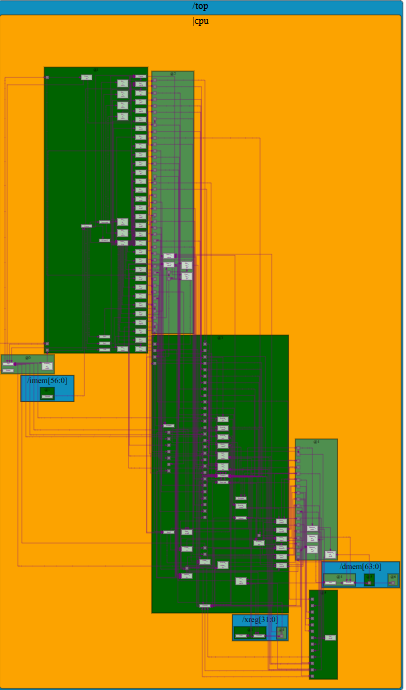
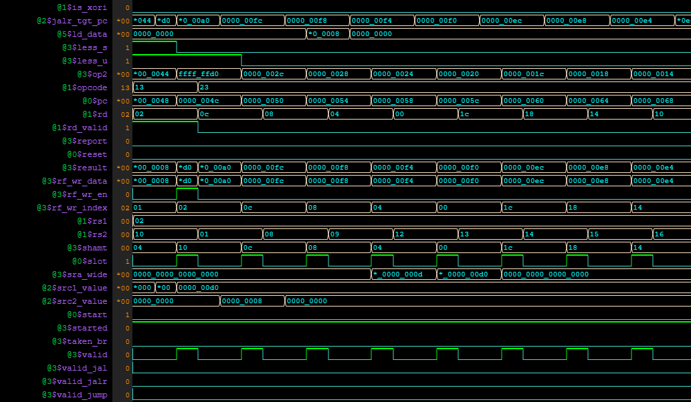

# GEMM on RVMYTH: Pipelined vs Non-Pipelined

Course project, **VSD RISC-V based MYTH Workshop**.

A 3x3 matrix multiply written in C is compiled to RV32I and run on two versions of my RVMYTH CPU. The project compares their latency and counts branch misses and penalty cycles.

## 1. Task

1. Write a C program for GEMM or convolution.
2. Compile it to RISC-V assembly.
3. Use the generated code as the test program for the RVMYTH CPU.
4. Compare pipelined and non-pipelined latency, and report branch misses and penalty cycles.

## 2. Program

[`c/gemm.c`](c/gemm.c) computes **C = A x B** (GEMM with alpha = 1 and beta = 0).

```
        | 1 2 3 |          | 9 8 7 |          |  30  24  18 |
    A = | 4 5 6 |      B = | 6 5 4 |      C = |  84  69  54 |
        | 7 8 9 |          | 3 2 1 |          | 138 114  90 |
```

RV32I has no multiply instruction, so `soft_mul()` multiplies using shifts and adds. This adds many branches, and their number depends on the values in B.

## 3. Compile to assembly

```sh
riscv64-unknown-elf-gcc -march=rv32i -mabi=ilp32 -O1 -ffreestanding -S c/gemm.c -o asm/gemm.s
sh scripts/build.sh          # assembly, disassembly and machine code
python3 scripts/make_tlv.py  # puts the machine code into both CPUs
```

Compiler used for the files here: GCC 13.2.0.

| File | Content |
|---|---|
| [`asm/gemm.s`](asm/gemm.s) | Assembly generated by GCC |
| [`asm/gemm.objdump.txt`](asm/gemm.objdump.txt) | Linked program with addresses |
| [`asm/gemm.hex`](asm/gemm.hex) | 75 machine-code words loaded into the CPU |


## 4. The two CPUs

| | Non-pipelined | Pipelined |
|---|---|---|
| New instruction | Every 3rd cycle | Every cycle |
| Instructions in flight | 1 | Several |
| Hazards | Previous instruction finishes first (load data is bypassed) | Register bypass; wrong-path instructions cancelled |
| Cost of a taken branch | No extra cycles | 2 cycles |
| File | [`tlv/rvmyth_nonpipelined.tlv`](tlv/rvmyth_nonpipelined.tlv) | [`tlv/rvmyth_pipelined.tlv`](tlv/rvmyth_pipelined.tlv) |

**What "non-pipelined" means here:** the same stages and datapath, but only one instruction at a time (the 3-cycle `$valid` method from the course). It is not a single-cycle CPU.

**Changes from my lab CPU:**

- ALU operations for the RV32I register and immediate arithmetic, logic, shift and compare instructions, plus `lui` and `auipc`
- Data memory increased to 64 words
- Instruction memory loaded with compiler-generated machine code
- Registers and data memory start at zero
- Hardware counters and a report printed in the log

Only `lw` and `sw` are supported for memory access.

**Branch prediction:** there is no predictor. Fetch continues to the next address, which is the same as always predicting *not taken*. Every **taken** conditional branch is therefore a **miss**, and cancels the next 2 instructions. Loads and jumps also cost 2 cycles each. They are counted separately and are not branch misses.

## 5. Results

These values come from the Verilog simulation of a plain-Verilog copy of the CPU. The Makerchip screenshots in section 7 are still to be added.

| Measurement | Non-pipelined | Pipelined |
|---|---:|---:|
| Instructions executed | 998 | 998 |
| **Latency (clock cycles)** | **2994** | **1580** |
| CPI | 3.000 | 1.583 |
| Conditional branches | 225 | 225 |
| Taken branches | 87 | 87 |
| **Branch misses** | 0 | **87** |
| **Branch penalty cycles** | 0 | **174** |
| Load penalty cycles | - | 126 (63 loads) |
| Jump penalty cycles | - | 282 (141 jumps) |

- **Speed-up in cycles:** 2994 / 1580 = **1.89**
- **Branch miss rate:** 87 / 225 = **38.7%**
- **Pipelined check:** 998 + 174 + 126 + 282 = **1580**
- **Non-pipelined check:** 3 x 998 = **2994**

The final `j halt` instruction and the start-up cycles before the first instruction reaches the execute stage are not counted.

These are clock cycles. Clock frequency was not measured, so this does not compare time in seconds.

### How these numbers were obtained

| Check | Status |
|---|---|
| C program run on a PC (expected matrix) | Matches |
| Instruction-level model, [`scripts/iss.py`](scripts/iss.py) ([log](logs/reference_model.log)) | 998 instructions; predicts 2994 and 1580 |
| Icarus Verilog run of a plain-Verilog copy, [`sim/`](sim) ([log](logs/iverilog_simulation.log)) | Both CPUs pass with the counts above |
| Makerchip, non-pipelined | Runs; start of the waveform shows 3 cycles per instruction. Final report pending |
| Makerchip, pipelined | Pending |

The GEMM program does not use every ALU operation, so this test does not verify the complete ALU.

## 6. Branch misses by branch

| PC | Where | Executed | Taken (miss) | Penalty cycles |
|---|---|---:|---:|---:|
| `0x014` | `soft_mul`: is `b` zero? | 27 | 0 | 0 |
| `0x028` | `soft_mul`: leave the loop | 75 | 27 | 54 |
| `0x030` | `soft_mul`: skip the add when the bit is 0 | 75 | 30 | 60 |
| `0x094` | Fill A and B: loop back | 9 | 8 | 16 |
| `0x0b8` | `j` loop: leave | 9 | 3 | 6 |
| `0x0e0` | `k` loop: loop back | 27 | 18 | 36 |
| `0x0ec` | `i` loop: leave | 3 | 1 | 2 |
| **Total** | | **225** | **87** | **174** |

(Counts from the instruction-level model.)

**Observations**

- 57 of the 87 misses are inside `soft_mul`. A hardware multiplier (the RV32M `mul` instruction) would remove these branches, but this CPU would need a multiplier added.
- Jumps cost the most penalty cycles (282). Many come from calling and returning from `soft_mul`, and from how GCC arranged the loops.
- Possible improvements: branch prediction, resolving jumps earlier, and stalling only when an instruction really needs the load data.

## 7. Makerchip screenshots

### Pipelined CPU




### Non-pipelined CPU

**Diagram**


**Final report log:** Pending.


**Waveform: one instruction every 3 cycles**



- `$valid` is high for 1 cycle in every 3.
- `$pc` holds each address for 3 cycles, then moves on (`0x48`, `0x4c`, `0x50`, ...).

**Waveform: counters at the start of the program**


- `$cnt_cycles` increases every cycle, while `$cnt_instr` increases every 3rd cycle.
- `$cnt_jump` becomes 1 after the first jump (the call to `main`).
- `$dmem_wr_en` pulses once every 3 cycles while `main` saves registers.

These views show only the start of the run. They do not show the final totals.

## 8. Run the Verilog simulation

Needs [Icarus Verilog](https://bleyer.org/icarus/). From this folder:

```sh
sh sim/run.sh
```

On Windows without `sh`:

```sh
iverilog -g2012 -o sim/gemm.vvp sim/rvmyth_core.v sim/tb.v
vvp sim/gemm.vvp
```

## 9. Folder structure

```
project_gemm/
├── README.md        this report
├── STEPS.md         how to run and add screenshots
├── c/               C program, start-up code, linker script
├── asm/             generated assembly and machine code
├── tlv/             pipelined and non-pipelined CPUs (Makerchip)
├── sim/             plain-Verilog copy and testbench
├── scripts/         build, TL-Verilog generator, reference model
├── logs/            simulation logs
└── images/          screenshots
```

## References

- [VSD RISC-V based MYTH workshop](https://www.vlsisystemdesign.com/riscv-based-myth/)
- [Course TL-Verilog repository](https://github.com/stevehoover/RISC-V_MYTH_Workshop) (the CPU follows its pipeline structure)
- [Makerchip](https://makerchip.com/)
